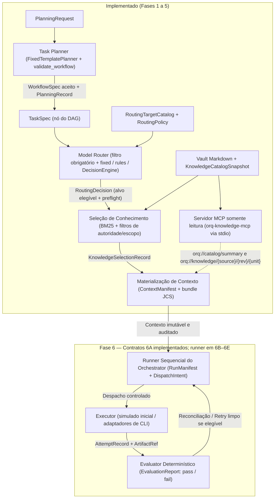

# ORQ

[](https://github.com/huguerra1/orq/actions/workflows/ci.yml)

[](LICENSE)

**Plataforma experimental de orquestração de agentes de IA em Python com MCP, projetada para desacoplar papéis, modelos, provedores, runtimes e executores sob contratos verificáveis, contexto auditável e avaliação determinística.**

O baseline documental v0.1 e as Fases 2–5 estão concluídos. Já existem contratos executáveis em JSON Schema, Vault Markdown com CLI atômica, servidor MCP somente leitura, Task Planner determinístico e Model Router com baselines `fixed`/`rules` e adaptador opcional TypeSafe/Jev. A especificação da Fase 6 foi aceita (ADR 0007) e o 6A entrega oito schemas de execução, fixtures e validação local; ainda não há runner do Orchestrator nem chamadas reais a provedores.

---

## Por que o ORQ existe

Orquestrar múltiplos agentes e modelos de IA em tarefas reais de engenharia de software costuma falhar em três pontos:

1. **Acoplamento invisível:** prompts de papel, modelo escolhido, provedor de inferência, runtime de ferramentas e CLI/SDK de execução ficam misturados no mesmo código, inviabilizando trocar um executor ou comparar arquiteturas (*Single-Agent* vs. *Multi-Agent*, roteamento por regras vs. LLM Router) sob condições controladas.
2. **Contexto sem procedência:** documentos inteiros são injetados no prompt sem controle de versão, escopo de autoridade, classificação de dados, orçamento de tokens ou verificação de integridade (hash).
3. **Execução sem evidência:** conclusão técnica de um processo (`completed`) é tratada como sucesso funcional (`pass`), falhas de rede geram *retries* sobre estados externos indeterminados e custos desconhecidos viram zero nos relatórios.

### Princípios

- **Separar identidades:** papel (`Agent Role`), modelo (`Model`), provedor (`Provider`), ambiente (`Runtime`) e adaptador (`Executor`) são contratos distintos.
- **Controle no Orchestrator, ferramentas no MCP:** o controle do workflow (estados, limites, tentativas e orçamento) fica na aplicação; o MCP fornece acesso restrito e auditável ao conhecimento e a ferramentas pequenas.
- **DAG local e sequencial primeiro:** começar com aplicação modular local e concorrência igual a um, preservando a estrutura explícita de DAG desde os schemas.
- **Conhecimento e contexto verificáveis:** separar conhecimento operacional e de projeto no Vault Markdown; cada tentativa recebe apenas unidades elegíveis, dentro do orçamento de tokens e assinadas com SHA-256 sobre JSON canônico (RFC 8785 / JCS).
- **Fatos e evidências desde o primeiro run:** registrar decisões de planejamento e roteamento, manifesto de contexto, tentativas, artefatos, custos conhecidos (`unknown` nunca vira zero) e avaliação determinística.
- **Especificação antes de código:** definir arquitetura, contratos, invariantes e cenários de aceitação antes de implementar cada fase.

---

## Arquitetura

O diagrama abaixo representa os módulos **já implementados (Fases 1–5)** e o **runner sequencial previsto na especificação aceita da Fase 6**. O incremento 6A já implementa os contratos desse runner; execução e armazenamento seguem em 6B–6E:



- **Onde entra o MCP:** o servidor `orq-knowledge-mcp` (Fase 3) recebe a raiz do Vault e um `KnowledgeCatalogSnapshot` imutável na inicialização, expondo apenas *resources* somente leitura (`orq://catalog/summary` sem caminhos físicos e `orq://knowledge/{source_id}/{revision}/{unit_id}` com reconfirmação de digest SHA-256). O modelo não faz busca livre nem altera a política de seleção do Orchestrator.
- **O que ainda não existe no código:** o runner sequencial do DAG, o armazenamento *append-only* de eventos de execução, o despacho para executores e a emissão em tempo de execução de `RunManifest`, `AttemptRecord` e `EvaluationReport` pertencem à Fase 6.

---

## Estado atual

| Fase | Status | Entrega |
| :--- | :--- | :--- |
| **Fase 1** | Concluída | Baseline normativo v0.1 aceito em revisão cruzada: glossário, contratos (`TaskSpec`, `WorkflowSpec`, perfis, política, roteamento, contexto, artefatos, registros, Vault) e 160 cenários de aceitação documentados. |
| **Fase 2** | Concluída | Contratos executáveis em JSON Schema Draft 2020-12, validação semântica de DAG/cobertura, digest SHA-256 sobre JCS (RFC 8785), Vault Markdown com seleção BM25 determinística, materialização de `ContextManifest`/bundle e CLI `orq-contracts`. |
| **Fase 3** | Concluída | Servidor MCP local somente leitura (`orq-knowledge-mcp`, SDK oficial `mcp==2.2.0` via `stdio`) expondo resumo sanitizado do catálogo e unidades exatas com verificação de integridade. |
| **Fase 4** | Concluída | Schemas de planejamento (`PlanningRequest`, `PlanningRecord`), interface `Planner`, baseline `FixedTemplatePlanner` e gate central de admissão (`plan_and_validate`) que impede planos inválidos de avançarem. |
| **Fase 5** | Concluída | Schemas e núcleo do `Model Router` (`route_and_finalize`) com filtro determinístico de elegibilidade, modos `fixed`/`rules`, interface `DecisionEngine`, motor simulado e adaptador opcional TypeSafe/Jev (`typesafe-sdk==0.7.2`). |
| **Fase 6** | Especificação aceita; 6A implementado | Oito schemas fechados, 22 fixtures e 276 testes do 6A aprovados. Próximo: journal e artefatos (6B), projeções (6C), executor/avaliador simulado (6D) e runner com `orq run simulate` (6E). |

Verificação local atual: 367 casos na suíte completa, com 337 aprovados e 30 erros de setup por `WinError 5` em `.pytest-tmp`. Os 276 testes do 6A passaram; a suíte integral precisa ser repetida em ambiente com temporários autorizados. Detalhes em [HANDOFF](docs/HANDOFF.md).

---

## Como rodar

Requer **Python 3.12+**. As dependências diretas e transitivas verificadas estão fixadas em [`requirements.lock`](requirements.lock):

```bash
python3 -m venv .venv
.venv/bin/python -m pip install -r requirements.lock
.venv/bin/python -m pip install --no-deps -e .
.venv/bin/python -m pytest
```

---

## Exemplo de uso da CLI

A CLI instalada pelo pacote é `orq-contracts` (além do servidor `orq-knowledge-mcp`). Os comandos abaixo utilizam apenas subcomandos, opções e arquivos reais presentes em [`fixtures/v0.1/`](fixtures/v0.1/):

### 1. Validar contratos e calcular digest canônico

```bash
# Valida estrutural e semanticamente uma tarefa mínima (retorna JSON com "valid": true e código 0)
.venv/bin/orq-contracts validate task fixtures/v0.1/valid/task-minimal.json

# Valida um workflow completo com verificação de DAG, dependências e cobertura de requisitos
.venv/bin/orq-contracts validate workflow fixtures/v0.1/valid/workflow-minimal.json

# Exemplo de rejeição determinística em fixture inválida (retorna "valid": false, lista de erros com JSON Pointer e código 1)
.venv/bin/orq-contracts validate task fixtures/v0.1/invalid/task-empty-objective.json

# Calcula o digest SHA-256 sobre a serialização canônica RFC 8785 (JCS) do documento
.venv/bin/orq-contracts digest fixtures/v0.1/valid/workflow-minimal.json
```

### 2. Executar a cadeia completa do Vault (catálogo → seleção → contexto)

Os subcomandos `vault` operam com escrita exclusiva (não sobrescrevem arquivos ou diretórios já existentes):

```bash
# 1. Ingere as fontes Markdown do Vault, valida frontmatter/digests e grava o KnowledgeCatalogSnapshot
.venv/bin/orq-contracts vault catalog \
  --root fixtures/v0.1/vault \
  --definition fixtures/v0.1/vault/catalog-definition.json \
  --output /tmp/orq-catalog.json

# 2. Filtra por projeto/autoridade/classificação/aplicabilidade, ranqueia via BM25 e grava o KnowledgeSelectionRecord
.venv/bin/orq-contracts vault select \
  --root fixtures/v0.1/vault \
  --catalog /tmp/orq-catalog.json \
  --request fixtures/v0.1/vault/selection-request.json \
  --output /tmp/orq-selection.json

# 3. Revalida os digests na origem e materializa manifest.json, bundle.json canônico e itens binários em /tmp/orq-context
.venv/bin/orq-contracts vault context \
  --root fixtures/v0.1/vault \
  --catalog /tmp/orq-catalog.json \
  --selection /tmp/orq-selection.json \
  --request fixtures/v0.1/vault/context-request.json \
  --output-dir /tmp/orq-context

# 4. Valida o ContextManifest gerado na etapa anterior
.venv/bin/orq-contracts validate context_manifest /tmp/orq-context/manifest.json
```

> **Nota sobre Planner e Router:** as funções `plan_and_validate` (Fase 4) e `route_and_finalize` (Fase 5) já estão implementadas e testadas na API Python (`orq_contracts`) usando as fixtures `fixtures/v0.1/planning-request.json`, `fixtures/v0.1/routing-request.json`, `fixtures/v0.1/routing-target-catalog.json` e `fixtures/v0.1/routing-policy-rules.json`. A exposição de subcomandos de planejamento, roteamento e execução simulada na CLI faz parte do backlog da Fase 6.

---

## Estrutura do repositório

- [`src/orq_contracts/`](src/orq_contracts/): pacote Python com canonicalização JCS/SHA-256 (`canonical.py`), registro de schemas (`schemas.py`), validador estrutural e semântico (`validator.py`), ingestão do Vault (`vault.py`), seleção BM25 (`selection.py`), materialização de contexto (`context.py`), servidor MCP (`mcp_server.py`), Task Planner (`planner.py`), Model Router (`router.py`), adaptador TypeSafe/Jev (`jev.py`) e CLI (`cli.py`).
- [`schemas/v0.1/`](schemas/v0.1/): 21 schemas JSON Schema (Draft 2020-12) para tipos comuns, tarefas, workflows, conhecimento, contexto, planejamento, roteamento e os oito contratos fechados de execução do 6A.
- [`fixtures/v0.1/`](fixtures/v0.1/): contratos válidos e inválidos, solicitações de planejamento e roteamento, catálogo de destinos e um Vault Markdown de demonstração.
- [`tests/`](tests/): suíte automatizada em `pytest` cobrindo canonicalização, validadores, Vault, seleção, contexto, CLI, servidor MCP (em memória e subprocesso `stdio`), Planner, Router e adaptador Jev.
- [`docs/`](docs/): estado operacional (`HANDOFF.md`), glossário normativo, especificações das Fases 1 a 6 e Architecture Decision Records (`docs/adr/`).

---

## Documentação e leitura inicial

1. [Glossário da plataforma](docs/glossary.md).
2. [Escopo e andamento da Fase 1](docs/phase-1/README.md).
3. [Contrato de tarefa (`TaskSpec`)](docs/phase-1/task-contract.md).
4. [Contrato de workflow (`WorkflowSpec`)](docs/phase-1/workflow-contract.md).
5. [Estados, limites e tentativas](docs/phase-1/execution-lifecycle.md).
6. [Cenários de aceitação](docs/phase-1/acceptance-cases.md).
7. [Perfis de papel, modelo e executor](docs/phase-1/agent-profiles.md).
8. [Decisão de roteamento e manifesto de contexto](docs/phase-1/routing-context-contract.md).
9. [Política de execução (`ExecutionPolicy`)](docs/phase-1/execution-policy-contract.md).
10. [Artefatos, patches e relatórios](docs/phase-1/artifact-contract.md).
11. [Registros de execução e avaliação](docs/phase-1/execution-records-contract.md).
12. [Metadata de conhecimento do Vault](docs/phase-1/knowledge-metadata-contract.md).
13. [Revisão cruzada e fechamento do baseline v0.1](docs/phase-1/cross-review.md).
14. [Andamento da Fase 2 — Contratos executáveis e Vault local](docs/phase-2/README.md).
15. [Andamento da Fase 3 — MCP local de conhecimento](docs/phase-3/README.md).
16. [Andamento da Fase 4 — Task Planner e admissão do plano](docs/phase-4/README.md).
17. [Andamento da Fase 5 — Model Router](docs/phase-5/README.md).
18. [Andamento da Fase 6 — Especificação aceita e contratos 6A](docs/phase-6/README.md).

---

## Retomar em outra conversa

Leia [AGENTS.md](AGENTS.md) e [docs/HANDOFF.md](docs/HANDOFF.md) antes de continuar. Eles registram as regras de trabalho, as decisões fechadas, o estado atual e o próximo passo concreto. O checklist de acompanhamento do portfólio está em [ROADMAP.md](ROADMAP.md).

---

## Próximos passos

Coerentes com o [ROADMAP.md](ROADMAP.md) e o [docs/HANDOFF.md](docs/HANDOFF.md):

1. **6B — Journal e artefatos:** implementar armazenamento append-only com os contratos do 6A, hashes JCS, idempotência, lock e limites de 1 MiB por linha/8 MiB por artefato.
2. **6C–6E — Runner sequencial e executor simulado:** implementar projeções e transições, executor/avaliador local e o fluxo completo `planner → router → contexto → tentativa → avaliação`, com CLI aceita `orq run simulate`.
3. **Adaptadores de executor para CLIs de agentes:** integrar adaptadores reais para **Claude Code**, **Codex**, **Gemini / Antigravity** e **Kiro**, mantendo a separação estrita entre papel, modelo, provedor, runtime e executor.
4. **Fases seguintes do roadmap (Fases 7–12):** segundo provedor/runtime para comparação experimental, Evaluator e Execution Memory ampliados, relatórios de métricas/custos, execução concorrente do DAG e scheduling experimental.

---

## Licença

Distribuído sob a licença MIT. Consulte o arquivo [LICENSE](LICENSE) para mais detalhes.
