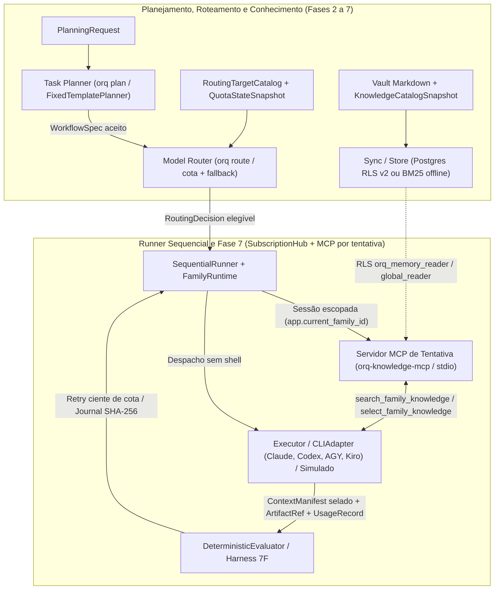

# ORQ

[](https://github.com/huguerra1/orq/actions/workflows/ci.yml)

[](LICENSE)

**Plataforma experimental de orquestração de agentes de IA em Python com MCP, projetada para desacoplar papéis, modelos, provedores, runtimes e executores sob contratos verificáveis, contexto auditável e avaliação determinística.**

O baseline documental v0.1 e as Fases 2–6 estão concluídos, e os incrementos **7A–7F** da **Fase 7** estão implementados na arquitetura local/CI: contratos de assinaturas e cota, banco PostgreSQL com RLS particionada (`orq_memory_reader`) e modo de controle `shared_global` (`orq_memory_global_reader`), busca híbrida (`postgres_fts_trgm`) + fallback offline BM25 (`bm25-v1`), quatro adaptadores de CLI (`ClaudeCodeAdapter`, `CodexAdapter`, `AgyAdapter`, `KiroAdapter`) com conector MCP nativo por tentativa e supervisão POSIX/WSL, runner ciente de cota com `FamilyRuntime`/`SubscriptionHub`, harness executável do **Experimento 7F** (`Q28`–`Q30`) e CLI (`orq plan`, `orq route`, `orq run simulate`, `orq adapters probe-versions`, `orq experiment-7f`). O gate real **V01–V12** contra binários vivos de assinatura continua aberto aguardando sessão real com `ArtifactRef` por versão.

---

## Por que o ORQ existe

Orquestrar múltiplos agentes e modelos de IA em tarefas reais de engenharia de software costuma falhar em três pontos:

1. **Acoplamento invisível:** prompts de papel, modelo escolhido, provedor de inferência, runtime de ferramentas e CLI/SDK de execução ficam misturados no mesmo código, inviabilizando trocar um executor ou comparar arquiteturas (*Single-Agent* vs. *Multi-Agent*, roteamento por regras vs. LLM Router) sob condições controladas.
2. **Contexto sem procedência:** documentos inteiros são injetados no prompt sem controle de versão, escopo de autoridade, classificação de dados, orçamento de tokens ou verificação de integridade (hash).
3. **Execução sem evidência:** conclusão técnica de um processo (`completed`) é tratada como sucesso funcional (`pass`), falhas de rede geram *retries* sobre estados externos indeterminados e custos desconhecidos viram zero nos relatórios.

### Princípios

- **Separar identidades:** papel (`Agent Role`), modelo (`Model`), provedor (`Provider`), ambiente (`Runtime`) e adaptador (`Executor`) são contratos distintos.
- **Controle no Orchestrator, ferramentas no MCP:** o controle do workflow (estados, limites, tentativas e orçamento) fica na aplicação; o MCP fornece acesso restrito e auditável ao conhecimento e a ferramentas pequenas.
- **DAG local e sequencial primeiro:** começar com aplicação modular local e concorrência igual a um, preservando a estrutura explícita de DAG desde os schemas.
- **Conhecimento e contexto verificáveis:** separar conhecimento operacional e de projeto no Vault Markdown; cada tentativa recebe apenas unidades elegíveis, dentro do orçamento de tokens e assinadas com SHA-256 sobre JSON canônico (RFC 8785 / JCS).
- **Fatos e evidências desde o primeiro run:** registrar decisões de planejamento e roteamento, manifesto de contexto, tentativas, artefatos, custos conhecidos (`unknown` nunca vira zero) e avaliação determinística.
- **Especificação antes de código:** definir arquitetura, contratos, invariantes e cenários de aceitação antes de implementar cada fase.

---

## Arquitetura

O diagrama abaixo representa os módulos implementados nas Fases 1–7 (`6E` + `7A–7F`). O runner encadeia contratos, planner, router ciente de cota, sessão MCP escopada por tentativa, memória particionada por família (`PostgreSQL RLS` ou `BM25` offline) e avaliador determinístico:



- **Onde entra o MCP:** o servidor `orq-knowledge-mcp` recebe a raiz do Vault (e, quando ativo, a configuração `Postgres`) com escopo fixado pelo host na sessão da tentativa (`AttemptKnowledgeSession`), expondo resources e tools somente leitura/escopadas (`search_family_knowledge` e `select_family_knowledge` + `orq://catalog/summary` e `orq://knowledge/{source_id}/{revision}/{unit_id}` com reconfirmação de digest SHA-256).
- **Próxima integração:** fechar o gate **V01–V12** com `ArtifactRef` em binários reais de assinatura e avançar na **Fase 8** (avaliador por modelo/rubrica sob ADR 0009).

---

## Estado atual

| Fase | Status | Entrega |
| :--- | :--- | :--- |
| **Fase 1** | Concluída | Baseline normativo v0.1 aceito em revisão cruzada: glossário, contratos (`TaskSpec`, `WorkflowSpec`, perfis, política, roteamento, contexto, artefatos, registros, Vault) e 160 cenários de aceitação documentados. |
| **Fase 2** | Concluída | Contratos executáveis em JSON Schema Draft 2020-12, validação semântica de DAG/cobertura, digest SHA-256 sobre JCS (RFC 8785), Vault Markdown com seleção BM25 determinística, materialização de `ContextManifest`/bundle e CLI `orq-contracts`. |
| **Fase 3** | Concluída | Servidor MCP local somente leitura (`orq-knowledge-mcp`, SDK oficial via `stdio`) expondo resumo sanitizado do catálogo e unidades exatas com verificação de integridade. |
| **Fase 4** | Concluída | Schemas de planejamento (`PlanningRequest`, `PlanningRecord`), interface `Planner`, baseline `FixedTemplatePlanner` e gate central de admissão (`plan_and_validate`) que impede planos inválidos de avançarem. |
| **Fase 5** | Concluída | Schemas e núcleo do `Model Router` (`route_and_finalize`) com filtro determinístico de elegibilidade, modos `fixed`/`rules`, interface `DecisionEngine`, motor simulado e adaptador opcional TypeSafe/Jev (`typesafe-sdk==0.7.2`). |
| **Fase 6** | Concluída | Contratos, journal/artefatos, projeções/guardas, executor simulado, avaliador e runner com `orq run simulate`. S02 succeeded, S03 reproduzível byte a byte; 63 cenários auditados. |
| **Fase 7 (`7A–7F`)** | Implementada localmente / CI (gate real V01–V12 pendente) | Hub de assinaturas, detector de cota versionado, Postgres RLS (`orq_memory_reader` v1 + `orq_memory_global_reader` v2), busca híbrida FTS português + `pg_trgm` com fallback BM25 offline, adaptadores CLI com conector MCP nativo por tentativa, subcomandos `orq plan`/`orq route`/`orq adapters probe-versions`/`orq experiment-7f` e cenários `Q01`–`Q30`. |

Detalhes em [HANDOFF](docs/HANDOFF.md) e [Fase 7](docs/phase-7/README.md).

---

## Como rodar

Requer **Python 3.12+**. As dependências diretas e transitivas verificadas estão fixadas em [`requirements.lock`](requirements.lock):

```bash
python3 -m venv .venv
.venv/bin/python -m pip install -r requirements.lock
.venv/bin/python -m pip install --no-deps -e .
.venv/bin/python -m pytest
```

---

## Exemplo de uso da CLI

A CLI instalada pelo pacote é `orq-contracts` (além do servidor `orq-knowledge-mcp`). Os comandos abaixo utilizam apenas subcomandos, opções e arquivos reais presentes em [`fixtures/v0.1/`](fixtures/v0.1/):

### 1. Validar contratos e calcular digest canônico

```bash
# Valida estrutural e semanticamente uma tarefa mínima (retorna JSON com "valid": true e código 0)
.venv/bin/orq-contracts validate task fixtures/v0.1/valid/task-minimal.json

# Valida um workflow completo com verificação de DAG, dependências e cobertura de requisitos
.venv/bin/orq-contracts validate workflow fixtures/v0.1/valid/workflow-minimal.json

# Exemplo de rejeição determinística em fixture inválida (retorna "valid": false, lista de erros com JSON Pointer e código 1)
.venv/bin/orq-contracts validate task fixtures/v0.1/invalid/task-empty-objective.json

# Calcula o digest SHA-256 sobre a serialização canônica RFC 8785 (JCS) do documento
.venv/bin/orq-contracts digest fixtures/v0.1/valid/workflow-minimal.json
```

### 2. Executar a cadeia completa do Vault (catálogo → seleção → contexto)

Os subcomandos `vault` operam com escrita exclusiva (não sobrescrevem arquivos ou diretórios já existentes):

```bash
# 1. Ingere as fontes Markdown do Vault, valida frontmatter/digests e grava o KnowledgeCatalogSnapshot
.venv/bin/orq-contracts vault catalog \
  --root fixtures/v0.1/vault \
  --definition fixtures/v0.1/vault/catalog-definition.json \
  --output /tmp/orq-catalog.json

# 2. Filtra por projeto/autoridade/classificação/aplicabilidade, ranqueia via BM25 e grava o KnowledgeSelectionRecord
.venv/bin/orq-contracts vault select \
  --root fixtures/v0.1/vault \
  --catalog /tmp/orq-catalog.json \
  --request fixtures/v0.1/vault/selection-request.json \
  --output /tmp/orq-selection.json

# 3. Revalida os digests na origem e materializa manifest.json, bundle.json canônico e itens binários em /tmp/orq-context
.venv/bin/orq-contracts vault context \
  --root fixtures/v0.1/vault \
  --catalog /tmp/orq-catalog.json \
  --selection /tmp/orq-selection.json \
  --request fixtures/v0.1/vault/context-request.json \
  --output-dir /tmp/orq-context

# 4. Valida o ContextManifest gerado na etapa anterior
.venv/bin/orq-contracts validate context_manifest /tmp/orq-context/manifest.json
```

### 3. Fluxo ponta a ponta da CLI (`orq plan` → `orq route` → `orq run simulate`)

As etapas de planejamento, roteamento e execução simulada agora estão expostas diretamente na CLI `orq` (sem chamar rede nem provedores reais):

```bash
F=fixtures/v0.1

# 1. Propõe e valida o WorkflowSpec a partir de PlanningRequest + template minimal
orq plan \
  --request $F/planning-request.json \
  --template $F/valid/workflow-minimal.json \
  --output-record /tmp/orq-planning-record.json \
  --output-workflow /tmp/orq-workflow.json

# 2. Aplica elegibilidade + regras de prioridade e emite RoutingDecision assinada
orq route \
  --request $F/routing-request.json \
  --catalog $F/routing-target-catalog.json \
  --policy $F/routing-policy-rules.json \
  --output /tmp/orq-routing-decision.json

# 3. Executa o workflow de referência T1–T5 ponta a ponta no executor simulado
orq run simulate \
  --store-root /tmp/orq-store \
  --workflow $F/valid/workflow-reference.json \
  --request $F/run-request.json \
  --catalog $F/run-catalog.json \
  --policy $F/run-policy.json \
  --script $F/valid/simulation-script-reference.json \
  --knowledge-catalog $F/vault/catalog-snapshot.json \
  --vault-root $F/vault
```

Saída real de `orq plan` + `orq route`:

```json
{"planning_record_id":"planning-planning-request-demo","record_output":"/tmp/orq-planning-record.json","status":"accepted","workflow_output":"/tmp/orq-workflow.json"}
{"decision_status":"selected","effective_selection":{"recommended_target_id":"target-quality","rule":"priority_then_id","selected_target_id":"target-quality","used_fallback":false},"output":"/tmp/orq-routing-decision.json","routing_decision_id":"routing-request-T1-1"}
```

Para verificar e executar o **Experimento 7F** offline (e contra PostgreSQL quando `ORQ_MEMORY_DSN` estiver configurado):

```bash
orq experiment-7f verify-package --package-dir experiments/7f
orq experiment-7f simulate --package-dir experiments/7f --store-root /tmp/orq-7f-store --repetitions 1
orq experiment-7f audit --package-dir experiments/7f --store-root /tmp/orq-7f-store
```

---

## Estrutura do repositório

- [`src/orq_contracts/`](src/orq_contracts/): pacote Python com canonicalização JCS/SHA-256 (`canonical.py`), registro e validador de schemas (`schemas.py`, `validator.py`), Vault Markdown e backend híbrido/BM25 (`vault.py`, `selection.py`, `context.py`, `knowledge_backend.py`, `knowledge_choice.py`), store Postgres com RLS (`memory_store/`), MCP (`mcp_server.py`, `family_mcp.py`), Planner/Router (`planner.py`, `router.py`, `jev.py`), journal e artefatos (`journal.py`, `artifact_store.py`), projeções e máquina de estados (`projections.py`, `state_machine.py`), executores, adaptadores CLI e cota (`executor.py`, `adapters/`, `quota.py`, `subscription_hub.py`, `runner_family.py`), avaliador (`evaluator.py`), runner (`runner.py`), harness 7F (`experiment_7f.py`) e CLI (`cli.py`).
- [`schemas/v0.1/`](schemas/v0.1/): schemas JSON Schema (Draft 2020-12) cobrindo contratos das Fases 2–7.
- [`fixtures/v0.1/`](fixtures/v0.1/): contratos válidos e inválidos, solicitações de planejamento/roteamento, catálogo de destinos, fixtures reais de saída CLI e Vault Markdown.
- [`experiments/7f/`](experiments/7f/): pacote congelado do experimento 7F (50 unidades de conhecimento, 10 tarefas, plano balanceado em 6 lotes e manifesto assinado).
- [`tests/`](tests/): suíte automatizada em `pytest` cobrindo contratos, Vault, MCP, Postgres/RLS (no CI), adaptadores CLI, cenários da Fase 6, cenários `Q01–Q30` da Fase 7 e análise estatística 7F.
- [`docs/`](docs/): estado operacional (`HANDOFF.md`), glossário normativo, especificações das Fases 1 a 8 e Architecture Decision Records (`docs/adr/`).

---

## Documentação e leitura inicial

1. [Glossário da plataforma](docs/glossary.md).
2. [Escopo e andamento da Fase 1](docs/phase-1/README.md).
3. [Contrato de tarefa (`TaskSpec`)](docs/phase-1/task-contract.md).
4. [Contrato de workflow (`WorkflowSpec`)](docs/phase-1/workflow-contract.md).
5. [Estados, limites e tentativas](docs/phase-1/execution-lifecycle.md).
6. [Cenários de aceitação](docs/phase-1/acceptance-cases.md).
7. [Perfis de papel, modelo e executor](docs/phase-1/agent-profiles.md).
8. [Decisão de roteamento e manifesto de contexto](docs/phase-1/routing-context-contract.md).
9. [Política de execução (`ExecutionPolicy`)](docs/phase-1/execution-policy-contract.md).
10. [Artefatos, patches e relatórios](docs/phase-1/artifact-contract.md).
11. [Registros de execução e avaliação](docs/phase-1/execution-records-contract.md).
12. [Metadata de conhecimento do Vault](docs/phase-1/knowledge-metadata-contract.md).
13. [Revisão cruzada e fechamento do baseline v0.1](docs/phase-1/cross-review.md).
14. [Andamento da Fase 2 — Contratos executáveis e Vault local](docs/phase-2/README.md).
15. [Andamento da Fase 3 — MCP local de conhecimento](docs/phase-3/README.md).
16. [Andamento da Fase 4 — Task Planner e admissão do plano](docs/phase-4/README.md).
17. [Andamento da Fase 5 — Model Router](docs/phase-5/README.md).
18. [Andamento da Fase 6 — Especificação aceita e contratos 6A](docs/phase-6/README.md).
19. [Fase 7 — Hub de assinaturas pessoais, roteamento por cota, RLS e 7F](docs/phase-7/README.md) ([ADR 0008](docs/adr/0008-phase-7-subscription-hub-and-family-memory.md)).
20. [Fase 8 — Proposta de avaliador por modelo e rubrica](docs/phase-8/README.md) ([ADR 0009](docs/adr/0009-phase-8-model-and-rubric-evaluator.md)).

---

## Executar um run simulado

O workflow de referência T1–T5 roda inteiro com o executor simulado, sem rede. A primeira tentativa de T3 é reprovada e a segunda é aprovada:

```bash
F=fixtures/v0.1
orq run simulate --store-root /tmp/orq-store   --workflow $F/valid/workflow-reference.json --request $F/run-request.json   --catalog $F/run-catalog.json --policy $F/run-policy.json   --script $F/valid/simulation-script-reference.json   --knowledge-catalog $F/vault/catalog-snapshot.json --vault-root $F/vault
```

Saída real (2026-11-14):

```json
{"journal_digest":{"algorithm":"sha256","value":"2e571353f5f6a19eb8049e70cde2d93c7f6f2d5f93d93bb6da1b5aa0393af64c"},"run_id":"run-reference","state":"succeeded"}
```

Rodar de novo em outro `--store-root` produz o mesmo `journal_digest`, porque o journal é reproduzível byte a byte. O código de saída é 0 só quando o run termina `succeeded`. Repetir o comando no mesmo diretório falha com `run_exists`.

## Retomar em outra conversa

Leia [AGENTS.md](AGENTS.md) e [docs/HANDOFF.md](docs/HANDOFF.md) antes de continuar. Eles registram as regras de trabalho, as decisões fechadas, o estado atual e o próximo passo concreto. O checklist de acompanhamento do portfólio está em [ROADMAP.md](ROADMAP.md).

---

## Próximos passos

Coerentes com o [ROADMAP.md](ROADMAP.md) e o [docs/HANDOFF.md](docs/HANDOFF.md):

1. **Verificação viva V01–V12 e coleta Camada B (7F):** validar os quatro adaptadores de assinatura (`claude`, `codex`, `agy`, `kiro-cli`) contra binários reais com `ArtifactRef` por versão e executar os 6 lotes pareados do 7F.
2. **Fase 8 — avaliador por modelo e rubrica** ([ADR 0009](docs/adr/0009-phase-8-model-and-rubric-evaluator.md)): avaliação semântica `model_rubric` restrita a `task_attempt`, seleção cross-family com independência de modelo e calibração estatística.
3. **Fases seguintes do roadmap (Fases 9–12):** segundo provedor/runtime para comparação experimental, Execution Memory ampliada, relatórios de métricas/custos, execução concorrente do DAG e scheduling experimental.

---

## Licença

Distribuído sob a licença MIT. Consulte o arquivo [LICENSE](LICENSE) para mais detalhes.
