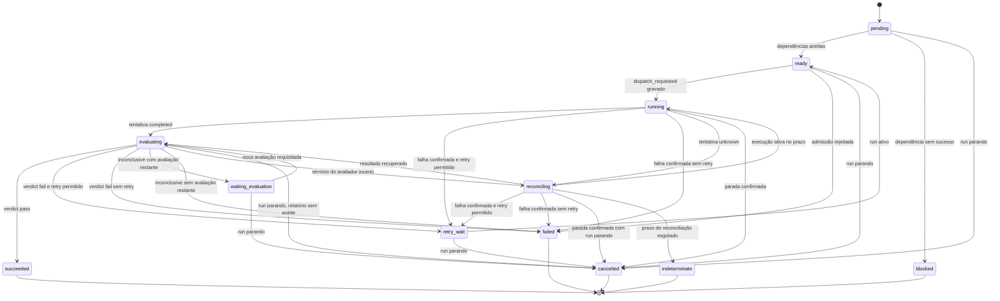
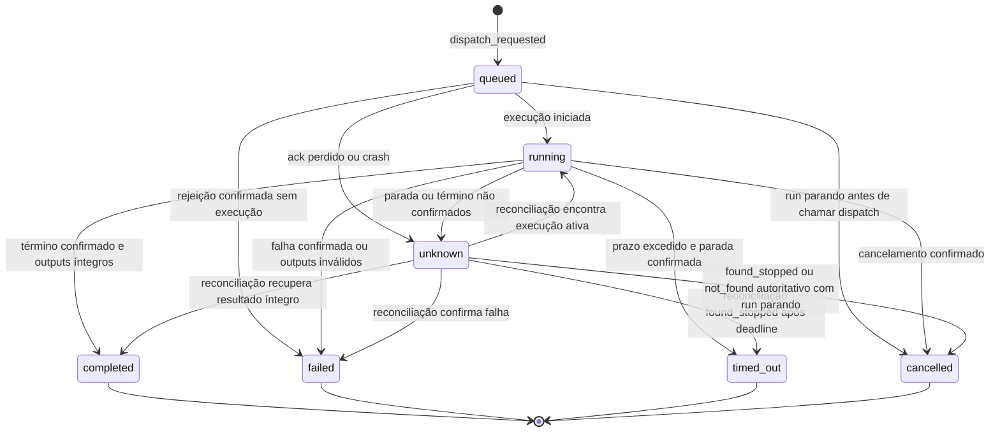
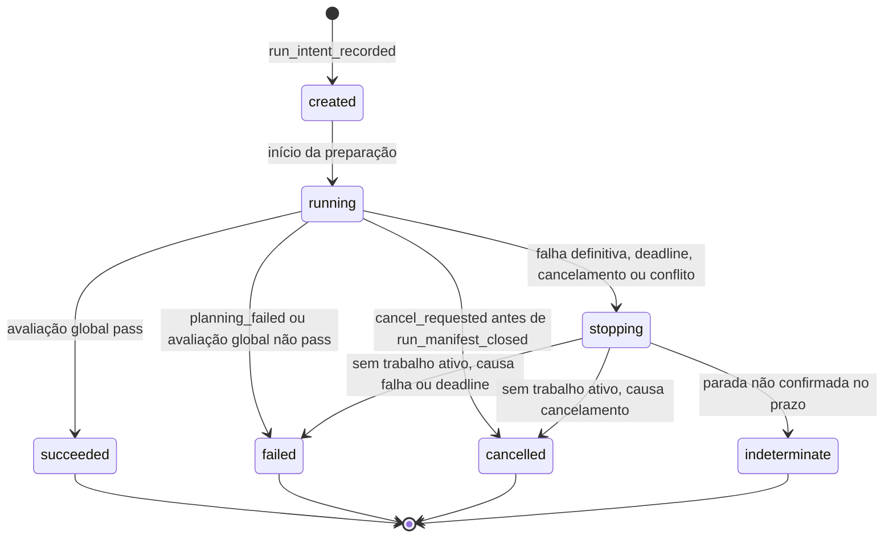

# Máquina de estados sequencial do runner

Estado: especificação aceita em 2026-11-10 ([ADR 0007](../adr/0007-phase-6-runner-and-simulated-executor.md)). O 6A implementa schemas, fixtures e validação local de critérios globais; journal, projeções, runner e executor seguem nos incrementos 6B–6E. Concretiza o [ciclo de execução](../phase-1/execution-lifecycle.md) para concorrência igual a um e executor simulado. Os 63 cenários ainda são especificação, não testes do runner executados.

Verificação atual: 276 testes do 6A aprovados. Na suíte completa (367 casos), 337 passaram e 30 tiveram erro de setup por permissão em `.pytest-tmp`; ver [HANDOFF](../HANDOFF.md). Os schemas validam estados por agregado; o validador de transições ainda será implementado no 6C.

## Problema

O ciclo da Fase 1 define estados e transições de tarefa e tentativa, mas não diz em que ordem o runner chama Planner, Router, materializador de contexto, executor e avaliador, nem o que fazer quando cada passo falha. Também não diz como o runner retoma após crash sem repetir um despacho cujo resultado é desconhecido.

## Princípios

1. **Um escritor, um laço.** O runner é um processo síncrono que avança uma tarefa por vez. Concorrência é `1`; a avaliação ocupa o mesmo slot da tentativa.
2. **Intenção antes do efeito.** Toda chamada ao executor ou ao avaliador é precedida pelo evento de intenção já sincronizado em disco ([protocolo de escrita](run-contracts.md#protocolo-de-escrita)).
3. **Estado derivado do journal.** O estado corrente é a projeção dos eventos; o runner não mantém estado autoritativo em memória entre passos.
4. **Incerteza bloqueia.** `unknown` em despacho, término ou avaliação leva a reconciliação; nunca a retry.
5. **Nenhum passo pula o validador de transições.** Uma transição cujo `from` não coincide com o estado projetado é rejeitada.

## Laço principal

```text
iniciar_run(pedido):
  gravar run_intent_recorded                          run: created
  transição run created → running
  se houver cancel_requested: fechar manifesto cancelled_before_ready; run → cancelled (RN04); fim
  plan_and_validate(...) → gravar planning_recorded
  se não aceito: fechar manifesto planning_failed; run → failed; fim
  vincular entradas externas; resolver limites e orçamento
  se houver cancel_requested: fechar manifesto cancelled_before_ready; run → cancelled (RN04); fim
  gravar run_manifest_closed (ready)

laço enquanto run == running:
  se agora ≥ fim do run: gravar deadline_exceeded; run → stopping; sair
  se houver cancel_requested: run → stopping; sair
  promover tarefas pending cujas dependências têm outputs_accepted → ready
  tarefa = primeira em ready ou retry_wait, pela ordem de WorkflowSpec.tasks
  se nenhuma e todas succeeded: avaliação global; sair
  se nenhuma: erro interno (DAG sem progresso); run → stopping; sair
  se retry_wait: transição retry_wait → ready
  admitir(tarefa)                                     ver pipeline de admissão
  se rejeitada: tarefa → failed; run → stopping; sair
  executar_tentativa(tarefa)                          ver ciclo da tentativa
  avaliar ou reconciliar conforme o estado da tentativa
  se tarefa terminou failed ou indeterminate: run → stopping; sair

parar():
  fechar admissões
  cancelar trabalho ativo e reconciliar a parada
  tarefas com dependência em failed, blocked ou indeterminate → blocked (TK02)
  demais não iniciadas ou em evaluating → cancelled (TK24)
  run → failed | cancelled | indeterminate
  gravar run_closed com cutoff
```

`run_closed` só aceita tarefas terminais no resumo. Se a preparação não resolveu orçamento (`planning_failed`/`cancelled_before_ready`), a moeda pode ser null, sem valor inventado.

## Pipeline de admissão

Passos executados para cada tentativa candidata, na ordem abaixo. Falha em qualquer passo antes do passo 8 **não cria tentativa e não consome `max_attempts`**, mas os registros produzidos (seleção, decisão, uso, erro) permanecem no journal.

| Passo | Operação | Registro | Falha |
| --- | --- | --- | --- |
| 1 | Verificar limites: tentativas restantes, tempo restante do run | Nenhum | `admission_rejected` (`attempts_exhausted`, `run_deadline`) |
| 2 | Vincular entradas: externas do manifesto e `outputs_accepted` das dependências diretas | Nenhum | `admission_rejected` (`inputs_unavailable`) |
| 3 | Selecionar conhecimento sobre o catálogo fixo do run (`select_knowledge`) | `knowledge_selection_recorded` | Status fora de `satisfied`/`partial` → `admission_rejected` (`knowledge_unsatisfied`) |
| 4 | Montar RoutingRequest com `candidate_attempt_number` = próximo número | Nenhum | Erro de validação → `admission_rejected` |
| 5 | Checks anteriores ao contexto (credenciais, quota e limites do destino; no simulado, todos derivados do roteiro) e `route_and_finalize` | `routing_decision_recorded` | `effective_selection` nulo → `admission_rejected` com o `decision_status`. Decisão com `effective_selection` preenchido segue, inclusive por fallback (`used_fallback: true` com `decision_status` `low_confidence`, `invalid_response` ou `provider_error`), como já produz `route_and_finalize` |
| 6 | Materializar contexto com `routing_decision_ref` = ref da decisão finalizada (`materialize_knowledge_context`) | `context_manifest_recorded` | `ContextError` → `admission_rejected` (`context_rejected`) |
| 7 | Checks de admissão: `context_integrity`, `knowledge_status` (sobre as asserções descritas em [run-contracts.md](run-contracts.md#dispatchintent)), `attempts_remaining`, `run_time_remaining`, `budget`, `inputs_accepted`; reservar execução e avaliação | `budget_reserved` (uma ou duas linhas) | Qualquer check não `passed` → `budget_released` + `admission_rejected` |
| 8 | Gravar cabeçalho da tentativa e DispatchIntent | `dispatch_requested` | Falha de gravação → nenhum despacho; run → stopping |
| 9 | Transição da tarefa `ready → running` | `state_transition` | |
| 10 | Se houver `cancel_requested` do run gravado depois de `dispatch_requested`: run → `stopping`, AT04 e TK09, sem chamar o executor. Senão, `executor.dispatch(intent, bundle, workspace)` | `dispatch_acknowledged` ou `error_attached` | Ver ciclo da tentativa |

Entradas externas têm descritor `artifact_ingested` no agregado `run` antes do manifesto `ready`. Erros da admissão usam `error_attached` na tarefa. As reservas aceitam `status: unavailable` com `amount: null` quando a política admite sem estimativa e sem teto obrigatório; não se inventa zero. Os motivos de rejeição são o enum de [run-contracts.md](run-contracts.md#errorrecord); erro de validação do RoutingRequest usa `policy_rejected`.

### Divergência em relação à Fase 1

O [contrato de roteamento e contexto](../phase-1/routing-context-contract.md) prevê que o check de integridade do contexto seja registrado nos `preflight_checks` da RoutingDecision antes de finalizá-la, usando o ID do manifesto em rascunho. O código da Fase 5 exige `preflight_checks` como entrada de `route_and_finalize`, e o materializador da Fase 2 exige uma `routing_decision_ref` com digest. Os dois não podem ser satisfeitos ao mesmo tempo sem alterar código já entregue.

| Alternativa | Vantagem | Limitação |
| --- | --- | --- |
| A. Checks dependentes do bundle no DispatchIntent (`admission_checks`) | Não altera Fases 2 e 5; a evidência fica no registro que de fato autoriza o despacho | RoutingDecision com `effective_selection` deixa de provar sozinha que o contexto cabia |
| B. Alterar `route_and_finalize` para finalizar em duas etapas | Fiel ao texto da Fase 1 | Muda contrato executável aceito e seus testes |
| C. Materializar contexto com referência provisória e regravar | Nenhuma | Viola imutabilidade do manifesto |

Decisão aceita: **A**, conforme ADR 0007. Uma RoutingDecision com `effective_selection` preenchido continua sem autoridade de despacho (como a Fase 5 já afirma); a autoridade é o DispatchIntent com todos os `admission_checks` aprovados. O schema do 6A exige os seis controles mínimos exatamente uma vez, todos `passed`.

### Rejeição de admissão

Na Fase 6 toda rejeição de admissão é definitiva para a tarefa (`ready → failed`). Indisponibilidade temporária com espera em `ready` até o deadline, prevista na Fase 1, não é modelada, porque o executor simulado não tem indisponibilidade transitória e um laço de espera sequencial bloquearia o run.

## Estados

### Run

| Estado | Significado | Terminal |
| --- | --- | --- |
| created | RunIntent gravado | Não |
| running | Preparação, tarefas e avaliação global | Não |
| stopping | Admissões fechadas; encerrando trabalho ativo | Não |
| succeeded | Todas as tarefas aceitas e avaliação global `pass` | Sim |
| failed | Falha definitiva, limite excedido ou avaliação global não aprovada | Sim |
| cancelled | Cancelamento solicitado e toda parada confirmada | Sim |
| indeterminate | Parada de algum trabalho externo não confirmada no prazo | Sim |

### Tarefa e tentativa

Os estados são os da Fase 1, sem acréscimos: tarefa em `pending`, `ready`, `running`, `evaluating`, `waiting_evaluation`, `retry_wait`, `reconciling`, `succeeded`, `failed`, `blocked`, `cancelled`, `indeterminate`; tentativa em `queued`, `running`, `completed`, `failed`, `timed_out`, `cancelled`, `unknown`.

Uma tentativa que permanece `unknown` ao fim da reconciliação não muda mais de estado; a tarefa vai para `indeterminate` e o workspace da tentativa não é reutilizado.

## Diagramas

### Tarefa



### Tentativa



### Run



## Tabelas de transição

Cada mudança entre estados existentes gera `state_transition` com `from`, `to`, `reason` e `evidence_event_ids`. A coluna "Evidência" lista os eventos que precisam existir antes. Criação é implícita: RN01 nasce em `run_intent_recorded`, AT01 em `dispatch_requested`, e tarefas `pending` em `run_manifest_closed` com manifesto `ready`. Esses casos não emitem `state_transition` nem usam `from: null`.

### Tentativa (AT)

| ID | De | Para | Evidência | Guarda |
| --- | --- | --- | --- | --- |
| AT01 | — | queued | `dispatch_requested` | Pipeline de admissão completo |
| AT02 | queued | running | `dispatch_acknowledged`, `execution_started` | |
| AT03 | queued | failed | `error_attached` com `termination_certainty: confirmed` e código `dispatch_failed` | O executor afirma, com evidência, que não iniciou; a `retryability` do ErrorRecord decide entre TK06 e TK07 |
| AT04 | queued | cancelled | `cancel_requested` do run gravado depois de `dispatch_requested` | Run em `stopping`; o runner ainda não chamou `executor.dispatch` no mesmo processo. Após crash nesse ponto não há essa prova: aplica-se AT05 |
| AT05 | queued | unknown | Exceção no despacho com certeza `unknown`, ou retomada após crash sem `dispatch_acknowledged` | |
| AT06 | running | completed | `termination_confirmed` (`finished`), `result_collected`, `artifact_ingested` e `output_bound` para todo output declarado | Todos os bytes passaram em tamanho, digest e contrato |
| AT07 | running | failed | `termination_confirmed` (`failed`), ou término `finished` com output ausente, contrato incompatível ou digest divergente | ErrorRecord com `retryability` explícita |
| AT08 | running | timed_out | `deadline_exceeded`, `cancel_requested`, `termination_confirmed` (`timeout`) | Confirmação obtida por `cancel` ou `observe` |
| AT09 | running | cancelled | `cancel_requested`, `termination_confirmed` (`cancel`) | Run em `stopping` |
| AT10 | running | unknown | Observação `unknown` ou `cancel` sem confirmação | |
| AT11 | unknown | running | `reconciliation_observed` (`found_running`) | `deadline_at` não atingido e run `running` |
| AT12 | unknown | completed | `reconciliation_observed` (`found_finished`) + mesmas evidências de AT06 | |
| AT13 | unknown | failed | `reconciliation_observed` (`found_failed`), ou `not_found` autoritativo com run `running` (código `dispatch_not_executed`, retryable), ou `found_stopped` sem `deadline_exceeded` nem `cancel_requested` anteriores (código `execution_failed`, `retryability: unknown`) | |
| AT14 | unknown | timed_out | `reconciliation_observed` (`found_stopped`) depois de `deadline_exceeded` da tentativa | |
| AT15 | unknown | cancelled | `reconciliation_observed` (`found_stopped`) depois de `cancel_requested` sem `deadline_exceeded`, ou `not_found` autoritativo | Run em `stopping` |

`found_running` com o run em `stopping` não volta a `running`: o runner pede `cancel` de novo e continua reconciliando dentro do prazo.

### Tarefa (TK)

| ID | De | Para | Evidência | Guarda |
| --- | --- | --- | --- | --- |
| TK01 | pending | ready | `outputs_accepted` de todas as dependências | Run `running` |
| TK02 | pending | blocked | Dependência direta ou transitiva em `failed`, `blocked` ou `indeterminate` | Run `stopping`. Dependência `cancelled` só ocorre por cancelamento do run e leva a TK24 |
| TK03 | ready | running | AT01 | |
| TK04 | ready | failed | `admission_rejected` | |
| TK05 | running | evaluating | AT06 | |
| TK06 | running | retry_wait | AT03, AT07 ou AT08 | [Retry permitido](#retry) |
| TK07 | running | failed | AT03, AT07 ou AT08 | Retry não permitido |
| TK08 | running | reconciling | AT05 ou AT10 | |
| TK09 | running | cancelled | AT04 ou AT09 | |
| TK10 | reconciling | running | AT11 | |
| TK11 | reconciling | evaluating | AT12, ou relatório de avaliação recuperado | |
| TK12 | reconciling | retry_wait | AT13 ou AT14 | Retry permitido |
| TK13 | reconciling | failed | AT13 ou AT14 | Retry não permitido |
| TK14 | reconciling | cancelled | AT15 | Run `stopping` |
| TK15 | reconciling | indeterminate | `reconciliation_timeout_ms` esgotado sem evidência conclusiva | |
| TK16 | evaluating | succeeded | `evaluation_report_recorded` com `pass`, depois `outputs_accepted` | Bindings idênticos aos avaliados |
| TK17 | evaluating | retry_wait | Relatório `fail` | Retry permitido e `retry_policy.on_evaluation_fail` |
| TK18 | evaluating | failed | Relatório `fail` | Retry não permitido |
| TK19 | evaluating | waiting_evaluation | Relatório `inconclusive` ou `not_run` | Avaliações restantes e orçamento |
| TK20 | evaluating | failed | Relatório `inconclusive` ou `not_run` | Sem avaliações restantes; motivo `evaluation_inconclusive` |
| TK21 | evaluating | reconciling | `evaluation_requested` sem término confirmado do verificador | |
| TK22 | waiting_evaluation | evaluating | Novo `evaluation_requested` | Mesmos `subject_bindings` |
| TK23 | retry_wait | ready | Nenhuma | Run `running`; tentativa anterior com término confirmado |
| TK24 | pending, ready, retry_wait, waiting_evaluation ou evaluating | cancelled | Run `stopping`; em `evaluating`, `evaluation_report_recorded` da avaliação em andamento | Motivo `run_cancelled` ou `workflow_failed`; sem trabalho ativo; nenhum `outputs_accepted`, mesmo com relatório `pass` |

### Run (RN)

| ID | De | Para | Evidência | Guarda |
| --- | --- | --- | --- | --- |
| RN01 | — | created | `run_intent_recorded` | |
| RN02 | created | running | Nenhuma | |
| RN03 | running | failed | `run_manifest_closed` com `planning_failed` | |
| RN04 | running | cancelled | `cancel_requested` antes de `run_manifest_closed`; manifesto `cancelled_before_ready` | Nenhuma tentativa existe |
| RN05 | running | succeeded | Todas as tarefas `succeeded`, relatório global `pass` | |
| RN06 | running | failed | Relatório global diferente de `pass` | Uma única avaliação global no MVP |
| RN07 | running | stopping | Tarefa terminal sem sucesso, `deadline_exceeded`, `cancel_requested` ou `idempotency_conflict` | |
| RN08 | stopping | failed | Nenhum trabalho ativo ou `unknown`; causa falha, deadline ou conflito | |
| RN09 | stopping | cancelled | Nenhum trabalho ativo ou `unknown`; causa cancelamento | |
| RN10 | stopping | indeterminate | Alguma tarefa `indeterminate` | |

Toda transição para estado terminal do run é seguida de `run_closed` com o cutoff.

## Timeout

1. O runner chama `observe(intent, until=deadline_at)`.
2. Se o término não chegou até `deadline_at`, grava `deadline_exceeded` e `cancel_requested`, e chama `cancel`.
3. Confirmação de parada → AT08 (`timed_out`). Sem confirmação → AT10 (`unknown`, motivo `timeout`) e reconciliação.
4. Retry após `timed_out` exige `retry_policy.on_confirmed_timeout`.

O prazo do run (`max_run_duration_ms`) é verificado antes de cada admissão e limita `deadline_at` e o prazo de reconciliação. Esgotado, o run vai para `stopping`.

## Reconciliação

1. Gravar `reconciliation_requested` com a mesma `dispatch_idempotency_key` **no payload**, o `external_call_id` conhecido e o prazo `min(agora + reconciliation_timeout_ms, fim do run)`. O envelope usa chave própria por requisição, por exemplo `<run_id>/<dispatch_intent_id>/reconcile/<n>`, estável ao repetir essa requisição; nunca reutiliza a chave do envelope do despacho com payload diferente.
2. Chamar `reconcile`. Gravar cada resposta como `reconciliation_observed`.
3. Aplicar AT11–AT15 conforme o `outcome`. `found_stopped` significa que o executor encontrou a execução parada sem resultado utilizável; ele só vira `timed_out` ou `cancelled` se houver pedido de parada anterior (`deadline_exceeded` ou `cancel_requested`), senão vira `failed` (AT13).
4. `not_found` só conta como prova de não execução se o executor declarar o controle `reconcile_not_found_authoritative` com evidência. O simulado declara; adaptadores reais começam como `unknown`, e para eles `not_found` é tratado como `unknown`.
5. Prazo esgotado sem evidência conclusiva → TK15 (`indeterminate`) e, em seguida, run `stopping`.

Reconciliação nunca grava novo `dispatch_requested` e não conta como tentativa.

Término incerto do avaliador (TK21) segue a mesma regra de prazo: a tarefa fica em `reconciling` aguardando o relatório daquele `evaluation_id` até `min(agora + reconciliation_timeout_ms, fim do run)`. O avaliador determinístico local não tem operação de reconciliação; no simulado, `unknown_termination` nunca produz relatório, então o prazo leva a TK15.

Erros e diagnósticos do avaliador são `error_attached` e `artifact_ingested` em `evaluation`. Execução diferente de `completed` só permite veredicto `inconclusive` ou `not_run` (S40). A reserva local é liberada por `budget_released` depois de término confirmado; sem UsageRecord real não se liquida reserva nem se afirma custo zero. Sem confirmação de término, a reserva permanece pendente.

## Retry

Retry é permitido somente se **todas** as condições valem:

| Condição | Fonte |
| --- | --- |
| Tentativa anterior em `failed`, `timed_out` ou `completed` com relatório `fail` | Projeção da tentativa |
| `termination_certainty: confirmed` | ErrorRecord, `termination_confirmed` ou `reconciliation_observed` conclusivo (AT13, AT14) |
| Motivo autorizado por `retry_policy` (`on_retryable_error`, `on_confirmed_timeout` ou `on_evaluation_fail`) | RunManifest |
| ErrorRecord com `retryability: retryable` quando a causa é técnica | ErrorRecord |
| `attempt_number < max_attempts` | Limites resolvidos |
| Run em `running` e tempo restante maior que zero | Projeção do run |
| Orçamento suficiente para nova tentativa e sua avaliação | Admissão (passo 7) |

Retry é proibido quando:

- a tentativa está `unknown` ou a tarefa está `reconciling`;
- a tentativa foi `cancelled` (cancelamento não autoriza retry);
- `retryability` é `non_retryable` ou `unknown`;
- o run está em `stopping`;
- o veredicto foi `fail` válido e `on_evaluation_fail` é `false`.

Cada retry passa de novo pelo pipeline de admissão inteiro: nova seleção de conhecimento sobre o mesmo catálogo, nova RoutingDecision, novo ContextManifest, novo workspace a partir da base e novo `attempt_id`. O feedback da avaliação anterior pode entrar no contexto como item com procedência; arquivos da tentativa anterior não entram.

## Cancelamento

1. `cancel_requested` no agregado `run` (ator `human`), gravado a qualquer momento.
2. Antes de `run_manifest_closed`: manifesto `cancelled_before_ready`, run `cancelled` (RN04).
3. Depois: run `stopping`. Nenhuma nova admissão ou avaliação começa.
4. Tentativa ativa: `cancel_requested` na tentativa e `cancel`. Confirmação → `cancelled`; sem confirmação → `unknown` e reconciliação até o prazo; sem evidência → `indeterminate`. Tentativa em `queued` cujo `executor.dispatch` ainda não foi chamado vai direto para `cancelled` (AT04), sem chamar o executor.
5. Avaliação em andamento no avaliador determinístico local termina antes de o runner processar o cancelamento, porque roda no mesmo processo; o relatório é gravado, mas não gera `outputs_accepted` nem retry, e a tarefa vai de `evaluating` para `cancelled` (TK24).
6. Tarefas não iniciadas → `cancelled` com motivo `run_cancelled` (TK24). Uma tarefa só vai para `blocked` (TK02) se depender de tarefa `failed`, `blocked` ou `indeterminate`.

## Retomada após crash

1. Adquirir `run.lock`; abrir e verificar o journal; descartar cauda truncada com `journal_tail_discarded`.
2. Reconstruir projeções.
3. Reservas ativas sem `dispatch_requested` correspondente → `budget_released` (motivo `admission_aborted`).
4. Tentativas em `queued`, `running` ou `unknown` → AT05/AT10 quando necessário e reconciliação pela mesma intenção. Nunca novo despacho.
5. `evaluation_requested` sem relatório: o avaliador é local, então o crash confirma seu término. Gravar relatório `execution_status: failed`, `verdict: not_run`; nova avaliação só dentro de `max_evaluations_per_attempt`.
6. Retomar o laço principal. Contadores não são zerados e não se cria outro `run_id`.

## Avaliação global

Com todas as tarefas `succeeded`, o runner grava `evaluation_requested` (`evaluation-workflow-1`) com `subject_bindings` iguais aos bindings aceitos que alimentam `WorkflowSpec.outputs`, avalia `WorkflowSpec.evaluation_criteria` com o avaliador determinístico e grava o relatório. Há uma única avaliação global no MVP. `pass` → RN05; qualquer outro veredicto → RN06.

## Executor simulado

O comportamento é lido de um roteiro versionado, cujo digest entra em `executor_snapshot` do RunManifest. Chave: `task_id` e `attempt_number`. Entradas ausentes usam `default`. O veredicto da avaliação global fica em `workflow_verifier`, com o mesmo formato de `verifier`.

```json
{
  "schema_version": "0.1",
  "script_id": "sim-script-demo",
  "version": "1",
  "clock": {"start": "2026-11-10T12:00:00Z", "step_ms": 1000},
  "reconcile_not_found_authoritative": true,
  "default": {
    "dispatch": "ack",
    "execution": "finish",
    "duration_ms": 1000,
    "on_cancel": "confirmed",
    "reconcile": "found_finished",
    "resolved_model_id": "sim-model-1",
    "usage": {"cost": {"status": "reported", "amount": "0.10", "currency": "USD"}},
    "outputs": "from_output_spec"
  },
  "attempts": {
    "T3": {
      "1": {"verifier": {"behavior-ok": "fail"}},
      "2": {"usage": {"cost": {"status": "unavailable", "amount": null, "currency": "USD"}}}
    }
  },
  "workflow_verifier": {"workflow-behavior-ok": "pass"}
}
```

No exemplo, `behavior-ok` e `workflow-behavior-ok` são valores de `pass_rule.script_key` dos critérios `simulated_verdict` de T3 e do workflow. A forma em lista, como `{"behavior-ok": ["inconclusive", "pass"]}`, roteiriza reavaliações da mesma tentativa (S24).

| Campo | Valores |
| --- | --- |
| dispatch | `ack`, `ack_lost` (efeito ocorre, confirmação não chega), `reject_confirmed` (executor recusa sem iniciar; ErrorRecord `dispatch_failed`, `retryable`, `confirmed`), `not_executed` (confirmação não chega e o efeito não ocorre) |
| execution | `finish`, `fail_retryable`, `fail_non_retryable`, `hang` (não termina antes do prazo) |
| on_cancel | `confirmed`, `unconfirmed` |
| reconcile | `found_running`, `found_finished`, `found_failed`, `found_stopped` (parada confirmada sem resultado), `not_found`, `unknown` |
| outputs | `from_output_spec` (JSON canônico determinístico por output), ou mapa por `output_id` com `omit`, `wrong_contract` ou `declared_digest_mismatch` |
| usage.cost | `reported`, `estimated` ou `unavailable` |
| verifier | Mapa indexado pelo `script_key` do `pass_rule` do critério com método `simulated_verdict`. O valor é um veredicto (`pass`, `fail`, `inconclusive`, `not_run` ou `unknown_termination`), usado em toda avaliação da tentativa, ou uma lista em que a posição `n` vale para `evaluation_number` = `n + 1`. Avaliação além do fim da lista ou `script_key` ausente invalidam o roteiro |
| crash_after | Opcional, apenas em testes: nome do evento após o qual o harness interrompe o runner |
| cancel_after | Opcional, apenas em testes: nome do evento após o qual o harness grava `cancel_requested` no agregado `run`, sem interromper o runner |

O simulado não lê o bundle além de verificar seu digest, não acessa rede e só escreve no diretório de artefatos do run.
