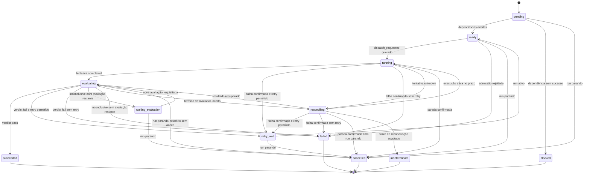
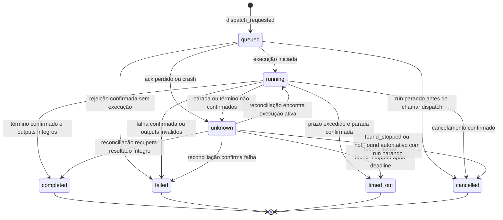
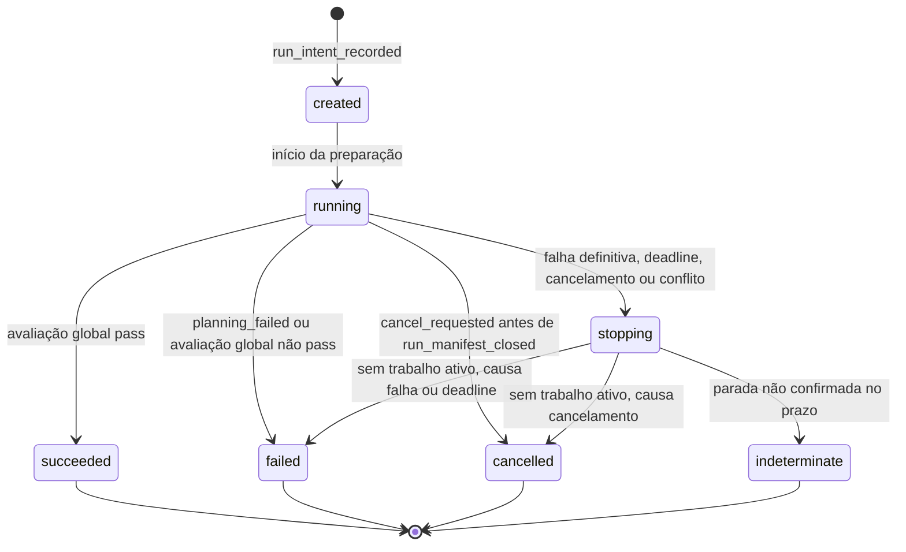

# Máquina de estados sequencial do runner

Estado: especificação aceita em 2026-11-10 ([ADR 0007](../adr/0007-phase-6-runner-and-simulated-executor.md)); 6A–6E implementados. Runner e CLI locais entregues em 2026-11-14. Os 63 cenários têm automação fiel (S04 revisado em 2026-11-14). Ver [cobertura](acceptance-scenarios.md#cobertura-executada-no-6e) e notas abaixo.

Verificação do 6C após correção dos achados 1–13: 217 testes próprios aprovados, incluindo cada uma das 49 linhas AT/TK/RN, saltos proibidos entre estados, guardas negativas e sequências de eventos locais com RunJournal. A suíte integral pós-revisão cabe ao orquestrador. Histórico dos incrementos no [HANDOFF](../HANDOFF.md); esses testes não executam o runner do 6E.

## Problema

O ciclo da Fase 1 define estados e transições de tarefa e tentativa, mas não diz em que ordem o runner chama Planner, Router, materializador de contexto, executor e avaliador, nem o que fazer quando cada passo falha. Também não diz como o runner retoma após crash sem repetir um despacho cujo resultado é desconhecido.

## Princípios

1. **Um escritor, um laço.** O runner é um processo síncrono que avança uma tarefa por vez. Concorrência é `1`; a avaliação ocupa o mesmo slot da tentativa.
2. **Intenção antes do efeito.** Toda chamada ao executor ou ao avaliador é precedida pelo evento de intenção já sincronizado em disco ([protocolo de escrita](run-contracts.md#protocolo-de-escrita)).
3. **Estado derivado do journal.** O estado corrente é a projeção dos eventos; o runner não mantém estado autoritativo em memória entre passos.
4. **Incerteza bloqueia.** `unknown` em despacho, término ou avaliação leva a reconciliação; nunca a retry.
5. **Nenhum passo pula o validador de transições.** Uma transição cujo `from` não coincide com o estado projetado é rejeitada.

## Laço principal

```text
iniciar_run(pedido):
  gravar run_intent_recorded                          run: created
  transição run created → running
  se houver cancel_requested: fechar manifesto cancelled_before_ready; run → cancelled (RN04); fim
  plan_and_validate(...) → gravar planning_recorded
  se não aceito: fechar manifesto planning_failed; run → failed; fim
  vincular entradas externas; resolver limites e orçamento
  se houver cancel_requested: fechar manifesto cancelled_before_ready; run → cancelled (RN04); fim
  gravar run_manifest_closed (ready)

laço enquanto run == running:
  se agora ≥ fim do run: gravar deadline_exceeded; run → stopping; sair
  se houver cancel_requested: run → stopping; sair
  promover tarefas pending cujas dependências têm outputs_accepted → ready
  tarefa = primeira em ready ou retry_wait, pela ordem de WorkflowSpec.tasks
  se nenhuma e todas succeeded: avaliação global; sair
  se nenhuma: erro interno (DAG sem progresso); run → stopping; sair
  se retry_wait: transição retry_wait → ready
  admitir(tarefa)                                     ver pipeline de admissão
  se rejeitada: tarefa → failed; run → stopping; sair
  executar_tentativa(tarefa)                          ver ciclo da tentativa
  avaliar ou reconciliar conforme o estado da tentativa
  se tarefa terminou failed ou indeterminate: run → stopping; sair

parar():
  fechar admissões
  cancelar trabalho ativo e reconciliar a parada
  tarefas com dependência em failed, blocked ou indeterminate → blocked (TK02)
  demais não iniciadas ou em evaluating → cancelled (TK24)
  run → failed | cancelled | indeterminate
  gravar run_closed com cutoff
```

`run_closed` só aceita tarefas terminais no resumo. Se a preparação não resolveu orçamento (`planning_failed`/`cancelled_before_ready`), a moeda pode ser null, sem valor inventado.

## Pipeline de admissão

Passos executados para cada tentativa candidata, na ordem abaixo. Falha em qualquer passo antes do passo 8 **não cria tentativa e não consome `max_attempts`**, mas os registros produzidos (seleção, decisão, uso, erro) permanecem no journal.

| Passo | Operação | Registro | Falha |
| --- | --- | --- | --- |
| 1 | Verificar limites: tentativas restantes, tempo restante do run | Nenhum | `admission_rejected` (`attempts_exhausted`, `run_deadline`) |
| 2 | Vincular entradas: externas do manifesto e `outputs_accepted` das dependências diretas | Nenhum | `admission_rejected` (`inputs_unavailable`) |
| 3 | Selecionar conhecimento sobre o catálogo fixo do run (`select_knowledge`) | `knowledge_selection_recorded` | Status fora de `satisfied`/`partial` → `admission_rejected` (`knowledge_unsatisfied`) |
| 4 | Montar RoutingRequest com `candidate_attempt_number` = próximo número | Nenhum | Erro de validação → `admission_rejected` |
| 5 | Checks anteriores ao contexto (credenciais, quota e limites do destino; no simulado, todos derivados do roteiro) e `route_and_finalize` | `routing_decision_recorded` | `effective_selection` nulo → `admission_rejected` com o `decision_status`. Decisão com `effective_selection` preenchido segue, inclusive por fallback (`used_fallback: true` com `decision_status` `low_confidence`, `invalid_response` ou `provider_error`), como já produz `route_and_finalize` |
| 6 | Materializar contexto com `routing_decision_ref` = ref da decisão finalizada (`materialize_knowledge_context`) | `context_manifest_recorded` | `ContextError` → `admission_rejected` (`context_rejected`) |
| 7 | Checks de admissão: `context_integrity`, `knowledge_status` (sobre as asserções descritas em [run-contracts.md](run-contracts.md#dispatchintent)), `attempts_remaining`, `run_time_remaining`, `budget`, `inputs_accepted`; reservar execução e avaliação | `budget_reserved` (uma ou duas linhas) | Qualquer check não `passed` → `budget_released` + `admission_rejected` |
| 8 | Gravar cabeçalho da tentativa e DispatchIntent | `dispatch_requested` | Falha de gravação → nenhum despacho; run → stopping |
| 9 | Transição da tarefa `ready → running` | `state_transition` | |
| 10 | Se houver `cancel_requested` do run gravado depois de `dispatch_requested`: run → `stopping`, AT04 e TK09, sem chamar o executor. Senão, `executor.dispatch(intent, bundle, workspace)` | `dispatch_acknowledged` ou `error_attached` | Ver ciclo da tentativa |

Entradas externas têm descritor `artifact_ingested` no agregado `run` antes do manifesto `ready`. Erros da admissão usam `error_attached` na tarefa. As reservas aceitam `status: unavailable` com `amount: null` quando a política admite sem estimativa e sem teto obrigatório; não se inventa zero. Os motivos de rejeição são o enum de [run-contracts.md](run-contracts.md#errorrecord); erro de validação do RoutingRequest usa `policy_rejected`.

### Divergência em relação à Fase 1

O [contrato de roteamento e contexto](../phase-1/routing-context-contract.md) prevê que o check de integridade do contexto seja registrado nos `preflight_checks` da RoutingDecision antes de finalizá-la, usando o ID do manifesto em rascunho. O código da Fase 5 exige `preflight_checks` como entrada de `route_and_finalize`, e o materializador da Fase 2 exige uma `routing_decision_ref` com digest. Os dois não podem ser satisfeitos ao mesmo tempo sem alterar código já entregue.

| Alternativa | Vantagem | Limitação |
| --- | --- | --- |
| A. Checks dependentes do bundle no DispatchIntent (`admission_checks`) | Não altera Fases 2 e 5; a evidência fica no registro que de fato autoriza o despacho | RoutingDecision com `effective_selection` deixa de provar sozinha que o contexto cabia |
| B. Alterar `route_and_finalize` para finalizar em duas etapas | Fiel ao texto da Fase 1 | Muda contrato executável aceito e seus testes |
| C. Materializar contexto com referência provisória e regravar | Nenhuma | Viola imutabilidade do manifesto |

Decisão aceita: **A**, conforme ADR 0007. Uma RoutingDecision com `effective_selection` preenchido continua sem autoridade de despacho (como a Fase 5 já afirma); a autoridade é o DispatchIntent com todos os `admission_checks` aprovados. O schema do 6A exige os seis controles mínimos exatamente uma vez, todos `passed`.

### Rejeição de admissão

Na Fase 6 toda rejeição de admissão é definitiva para a tarefa (`ready → failed`). Indisponibilidade temporária com espera em `ready` até o deadline, prevista na Fase 1, não é modelada, porque o executor simulado não tem indisponibilidade transitória e um laço de espera sequencial bloquearia o run.

## Estados

### Run

| Estado | Significado | Terminal |
| --- | --- | --- |
| created | RunIntent gravado | Não |
| running | Preparação, tarefas e avaliação global | Não |
| stopping | Admissões fechadas; encerrando trabalho ativo | Não |
| succeeded | Todas as tarefas aceitas e avaliação global `pass` | Sim |
| failed | Falha definitiva, limite excedido ou avaliação global não aprovada | Sim |
| cancelled | Cancelamento solicitado e toda parada confirmada | Sim |
| indeterminate | Parada de algum trabalho externo não confirmada no prazo | Sim |

### Tarefa e tentativa

Os estados são os da Fase 1, sem acréscimos: tarefa em `pending`, `ready`, `running`, `evaluating`, `waiting_evaluation`, `retry_wait`, `reconciling`, `succeeded`, `failed`, `blocked`, `cancelled`, `indeterminate`; tentativa em `queued`, `running`, `completed`, `failed`, `timed_out`, `cancelled`, `unknown`.

Uma tentativa que permanece `unknown` ao fim da reconciliação não muda mais de estado; a tarefa vai para `indeterminate` e o workspace da tentativa não é reutilizado.

## Diagramas

### Tarefa



### Tentativa



### Run



## Tabelas de transição

Cada mudança entre estados existentes gera `state_transition` com `from`, `to`, `reason` e `evidence_event_ids`. A coluna "Evidência" lista os eventos que precisam existir antes. Criação é implícita: RN01 nasce em `run_intent_recorded`, AT01 em `dispatch_requested`, e tarefas `pending` em `run_manifest_closed` com manifesto `ready`. Esses casos não emitem `state_transition` nem usam `from: null`.

### Tentativa (AT)

| ID | De | Para | Evidência | Guarda |
| --- | --- | --- | --- | --- |
| AT01 | — | queued | `dispatch_requested` | Pipeline de admissão completo |
| AT02 | queued | running | `dispatch_acknowledged`, `execution_started` | |
| AT03 | queued | failed | `error_attached` com `termination_certainty: confirmed` e código `dispatch_failed` | O executor afirma, com evidência, que não iniciou; a `retryability` do ErrorRecord decide entre TK06 e TK07 |
| AT04 | queued | cancelled | `cancel_requested` do run gravado depois de `dispatch_requested` | Run em `stopping`; o runner ainda não chamou `executor.dispatch` no mesmo processo. Após crash nesse ponto não há essa prova: aplica-se AT05 |
| AT05 | queued | unknown | Exceção no despacho com certeza `unknown`, ou retomada após crash sem `dispatch_acknowledged` | |
| AT06 | running | completed | `termination_confirmed` (`finished`), `result_collected`, `artifact_ingested` e `output_bound` para todo output declarado | Todos os bytes passaram em tamanho, digest e contrato |
| AT07 | running | failed | `termination_confirmed` (`failed`), ou término `finished` com output ausente, contrato incompatível ou digest divergente; ErrorRecord confirmado, citado e posterior ao término | Em `finished`, código `output_missing`, `output_contract_mismatch` ou `integrity_mismatch`; `retryability` explícita |
| AT08 | running | timed_out | `deadline_exceeded`, `cancel_requested`, `termination_confirmed` (`timeout`) | Confirmação obtida por `cancel` ou `observe` |
| AT09 | running | cancelled | `cancel_requested`, `termination_confirmed` (`cancel`) | Run em `stopping` |
| AT10 | running | unknown | Observação `unknown` ou `cancel` sem confirmação | |
| AT11 | unknown | running | `reconciliation_observed` (`found_running`) | `deadline_at` não atingido e run `running` |
| AT12 | unknown | completed | `reconciliation_observed` (`found_finished`) + mesmas evidências de AT06 | |
| AT13 | unknown | failed | `reconciliation_observed` (`found_failed`), ou `not_found` autoritativo com run `running` (código `dispatch_not_executed`, retryable), ou `found_stopped` sem `deadline_exceeded` nem `cancel_requested` anteriores (código `execution_failed`, `retryability: unknown`) | ErrorRecord confirmado, citado e posterior à observação |
| AT14 | unknown | timed_out | `reconciliation_observed` (`found_stopped`) depois de `deadline_exceeded` da tentativa | |
| AT15 | unknown | cancelled | `reconciliation_observed` (`found_stopped`) depois de `cancel_requested` sem `deadline_exceeded`, ou `not_found` autoritativo | Run em `stopping` |

`found_running` com o run em `stopping` não volta a `running`: o runner pede `cancel` de novo e continua reconciliando dentro do prazo.

### Tarefa (TK)

| ID | De | Para | Evidência | Guarda |
| --- | --- | --- | --- | --- |
| TK01 | pending | ready | `outputs_accepted` de todas as dependências | Run `running` |
| TK02 | pending | blocked | Dependência direta ou transitiva em `failed`, `blocked` ou `indeterminate` | Run `stopping`. Dependência `cancelled` só ocorre por cancelamento do run e leva a TK24 |
| TK03 | ready | running | AT01 | |
| TK04 | ready | failed | `admission_rejected` com `error_record_ids` não vazio, anexados à tarefa | Reservas do passo 7 liberadas antes da rejeição |
| TK05 | running | evaluating | AT06 | |
| TK06 | running | retry_wait | AT03, AT07 ou AT08 | [Retry permitido](#retry) |
| TK07 | running | failed | AT03, AT07 ou AT08 | Retry não permitido |
| TK08 | running | reconciling | AT05 ou AT10 | |
| TK09 | running | cancelled | AT04 ou AT09 | |
| TK10 | reconciling | running | AT11 | |
| TK11 | reconciling | evaluating | AT12, ou relatório de avaliação recuperado | |
| TK12 | reconciling | retry_wait | AT13 ou AT14 | Retry permitido |
| TK13 | reconciling | failed | AT13 ou AT14 | Retry não permitido |
| TK14 | reconciling | cancelled | AT15 | Run `stopping` |
| TK15 | reconciling | indeterminate | `reconciliation_timeout_ms` esgotado sem evidência conclusiva | |
| TK16 | evaluating | succeeded | `evaluation_report_recorded` com `pass`, depois `outputs_accepted` | Bindings idênticos aos avaliados |
| TK17 | evaluating | retry_wait | Relatório `fail` | Retry permitido e `retry_policy.on_evaluation_fail` |
| TK18 | evaluating | failed | Relatório `fail` | Retry não permitido |
| TK19 | evaluating | waiting_evaluation | Relatório `inconclusive` ou `not_run` | Avaliações restantes e orçamento |
| TK20 | evaluating | failed | Relatório `inconclusive` ou `not_run` | Sem avaliações restantes; motivo `evaluation_inconclusive` |
| TK21 | evaluating | reconciling | `evaluation_requested` sem término confirmado do verificador | |
| TK22 | waiting_evaluation | evaluating | Novo `evaluation_requested` | Mesmos `subject_bindings` |
| TK23 | retry_wait | ready | Nenhuma | Run `running`; tentativa anterior com término confirmado |
| TK24 | pending, ready, retry_wait, waiting_evaluation ou evaluating | cancelled | Run `stopping`; em `evaluating`, `evaluation_report_recorded` da avaliação em andamento | Motivo `run_cancelled` ou `workflow_failed`; sem trabalho ativo; nenhum `outputs_accepted`, mesmo com relatório `pass`; em `pending`, nenhuma dependência falha (caso contrário, TK02) |

### Run (RN)

| ID | De | Para | Evidência | Guarda |
| --- | --- | --- | --- | --- |
| RN01 | — | created | `run_intent_recorded` | |
| RN02 | created | running | Nenhuma | |
| RN03 | running | failed | `run_manifest_closed` com `planning_failed` | |
| RN04 | running | cancelled | `cancel_requested` antes de `run_manifest_closed`; manifesto `cancelled_before_ready` | Nenhuma tentativa existe |
| RN05 | running | succeeded | Todas as tarefas `succeeded`, relatório global `pass` | |
| RN06 | running | failed | Relatório global diferente de `pass` | Uma única avaliação global no MVP |
| RN07 | running | stopping | Tarefa terminal sem sucesso, `deadline_exceeded`, `cancel_requested` ou `idempotency_conflict` | Fixa a causa: cancelamento já pedido → `cancelled`; caso contrário → `failed` |
| RN08 | stopping | failed | Nenhum trabalho ativo ou `unknown`; causa fixada em RN07 = `failed` | Nenhuma tarefa `indeterminate` |
| RN09 | stopping | cancelled | Nenhum trabalho ativo ou `unknown`; causa fixada em RN07 = `cancelled` | Nenhuma tarefa `indeterminate` |
| RN10 | stopping | indeterminate | Alguma tarefa `indeterminate` | |

Toda transição para estado terminal do run é seguida de `run_closed` com o cutoff.

## Timeout

1. O runner chama `observe(intent, until=deadline_at)`.
2. Se o término não chegou até `deadline_at`, grava `deadline_exceeded` e `cancel_requested`, e chama `cancel`.
3. Confirmação de parada → AT08 (`timed_out`). Sem confirmação → AT10 (`unknown`, motivo `timeout`) e reconciliação.
4. Retry após `timed_out` exige `retry_policy.on_confirmed_timeout`.

O prazo do run (`max_run_duration_ms`) é verificado antes de cada admissão e limita `deadline_at` e o prazo de reconciliação. Esgotado, o run vai para `stopping`.

## Reconciliação

1. No primeiro `reconciliation_requested` da intenção, fixar e validar `deadline_at = min(recorded_at + reconciliation_timeout_ms, RunIntent.created_at + max_run_duration_ms)`. Pedidos seguintes da mesma intenção preservam exatamente esse prazo, sem antecipação nem prorrogação. Usar a mesma `dispatch_idempotency_key` **no payload** e o `external_call_id` conhecido. O envelope usa chave própria por requisição, por exemplo `<run_id>/<dispatch_intent_id>/reconcile/<n>`, estável ao repetir essa requisição; nunca reutiliza a chave do envelope do despacho com payload diferente.
2. Chamar `reconcile`. Gravar cada resposta como `reconciliation_observed`.
3. Aplicar AT11–AT15 conforme o `outcome`. `found_stopped` significa que o executor encontrou a execução parada sem resultado utilizável; ele só vira `timed_out` ou `cancelled` se houver pedido de parada anterior (`deadline_exceeded` ou `cancel_requested`), senão vira `failed` (AT13).
4. `not_found` só conta como prova de não execução se o executor declarar o controle `reconcile_not_found_authoritative` com evidência. O simulado declara; adaptadores reais começam como `unknown`, e para eles `not_found` é tratado como `unknown`.
5. Prazo esgotado sem evidência conclusiva → TK15 (`indeterminate`) e, em seguida, run `stopping`.

Reconciliação nunca grava novo `dispatch_requested` e não conta como tentativa.

Término incerto do avaliador (TK21) segue a mesma regra de prazo: a tarefa fica em `reconciling` aguardando o relatório daquele `evaluation_id` até `min(agora + reconciliation_timeout_ms, fim do run)`. O avaliador determinístico local não tem operação de reconciliação; no simulado, `unknown_termination` nunca produz relatório, então o prazo leva a TK15.

Erros e diagnósticos do avaliador são `error_attached` e `artifact_ingested` em `evaluation`. Execução diferente de `completed` só permite veredicto `inconclusive` ou `not_run` (S40). A reserva local é liberada por `budget_released` depois de término confirmado; sem UsageRecord real não se liquida reserva nem se afirma custo zero. Sem confirmação de término, a reserva permanece pendente.

## Retry

Retry é permitido somente se **todas** as condições valem:

| Condição | Fonte |
| --- | --- |
| Tentativa anterior em `failed`, `timed_out` ou `completed` com relatório `fail` | Projeção da tentativa |
| `termination_certainty: confirmed` | ErrorRecord, `termination_confirmed` ou `reconciliation_observed` conclusivo (AT13, AT14) |
| Motivo autorizado por `retry_policy` (`on_retryable_error`, `on_confirmed_timeout` ou `on_evaluation_fail`) | RunManifest |
| ErrorRecord com `retryability: retryable` quando a causa é técnica | Erro confirmado citado na transição de falha; erro antigo ou anexado depois não troca a causa do retry |
| `attempt_number < max_attempts` | Limites resolvidos |
| Run em `running` e tempo restante maior que zero | Projeção do run |
| Orçamento suficiente para nova tentativa e sua avaliação | Admissão (passo 7) |

Retry é proibido quando:

- a tentativa está `unknown` ou a tarefa está `reconciling`;
- a tentativa foi `cancelled` (cancelamento não autoriza retry);
- `retryability` é `non_retryable` ou `unknown`;
- o run está em `stopping`;
- o veredicto foi `fail` válido e `on_evaluation_fail` é `false`.

Cada retry passa de novo pelo pipeline de admissão inteiro: nova seleção de conhecimento sobre o mesmo catálogo, nova RoutingDecision, novo ContextManifest, novo workspace a partir da base e novo `attempt_id`. O feedback da avaliação anterior pode entrar no contexto como item com procedência; arquivos da tentativa anterior não entram.

## Cancelamento

1. `cancel_requested` no agregado `run` (ator `human`), gravado a qualquer momento.
2. Antes de `run_manifest_closed`: manifesto `cancelled_before_ready`, run `cancelled` (RN04).
3. Depois: run `stopping`. Nenhuma nova admissão ou avaliação começa.
4. Tentativa ativa: `cancel_requested` na tentativa e `cancel`. Confirmação → `cancelled`; sem confirmação → `unknown` e reconciliação até o prazo; sem evidência → `indeterminate`. Tentativa em `queued` cujo `executor.dispatch` ainda não foi chamado vai direto para `cancelled` (AT04), sem chamar o executor.
5. Avaliação em andamento no avaliador determinístico local termina antes de o runner processar o cancelamento, porque roda no mesmo processo; o relatório é gravado, mas não gera `outputs_accepted` nem retry, e a tarefa vai de `evaluating` para `cancelled` (TK24).
6. Tarefas não iniciadas → `cancelled` com motivo `run_cancelled` (TK24). Uma tarefa só vai para `blocked` (TK02) se depender de tarefa `failed`, `blocked` ou `indeterminate`.

## Retomada após crash

1. Adquirir `run.lock`; abrir e verificar o journal; descartar cauda truncada com `journal_tail_discarded`.
2. Reconstruir projeções.
3. Reservas ativas sem `dispatch_requested` correspondente → `budget_released` (motivo `admission_aborted`).
4. Tentativas em `queued`, `running` ou `unknown` → AT05/AT10 quando necessário e reconciliação pela mesma intenção. Nunca novo despacho.
5. `evaluation_requested` sem relatório, com tarefa ainda `evaluating` ou `reconciling`: o avaliador é local, então o crash confirma seu término. Gravar relatório `execution_status: failed`, `verdict: not_run`; nova avaliação só dentro de `max_evaluations_per_attempt`. Tarefa terminal não recebe relatório tardio nem libera sua reserva por retomada; usar `late_observation` para diagnóstico, preservando S59.
6. Retomar o laço principal. Contadores não são zerados e não se cria outro `run_id`.

## Avaliação global

Com todas as tarefas `succeeded`, o runner grava `evaluation_requested` (`evaluation-workflow-1`) com `subject_bindings` iguais aos bindings aceitos que alimentam `WorkflowSpec.outputs`, avalia `WorkflowSpec.evaluation_criteria` com o avaliador determinístico e grava o relatório. Há uma única avaliação global no MVP. `pass` → RN05; qualquer outro veredicto → RN06.

## Notas de implementação 6C

- API pura: `project_journal(events, workflow=..., as_of_global_sequence=...)`, `validate_transition(projection, event)` e `recovery_actions(projection)`. O WorkflowSpec é fornecido pelo chamador e conferido por identidade/versão/digest; o journal só contém sua referência. Evita duplicar o snapshot ou adicionar I/O à projeção. `validate_edge` confere apenas a aresta e o `from`; o validador completo também confere guardas e evidências anteriores explicitamente citadas. As tabelas imutáveis preservam todos os IDs, inclusive arestas compartilhadas e os cinco estados de origem de TK24.
- Replay usa `validate_instance`, confere a cadeia de envelopes e vínculos entre registros, e mantém criação implícita. `ProjectionError` e `StateMachineError` expõem `.code` estável; o primeiro também identifica `.event_id`. Exemplos: `transition_from_mismatch`, `transition_not_allowed`, `transition_evidence_missing`, `transition_guard_failed`, `dispatch_intent_reused`, `attempt_number_not_contiguous`, `attempts_exhausted`, `target_mismatch`, `bundle_hash_mismatch`, `evaluation_bindings_mismatch` e `outputs_without_pass`. Validação antes do append é responsabilidade do runner; o 6C não grava eventos nem transforma exceções de armazenamento em efeitos.
- Retomada devolve ações de uma etapa, exigindo nova projeção após executá-las. Reserva sem intenção é liberável por `admission_aborted`; despacho sem término comprovado exige reconciliação pela mesma chave, inclusive após falha de fsync e crash entre AT01 e TK03. Evidências conclusivas já gravadas permitem concluir a projeção. Avaliação local interrompida pede relatório `failed/not_run`, sem fabricar resultado de critérios. Tentativa de tarefa `indeterminate` não volta à execução. AT04 continua exigindo prova volátil de que dispatch não foi chamado no mesmo processo: o replay confere as condições observáveis; a retomada nunca oferece essa alternativa.
- `not_found` é conservador por padrão. O chamador só informa `reconcile_not_found_authoritative=True` após verificar o controle do executor; a observação ainda exige evidência. Bytes dos artefatos/bundle, controles externos e saldo/tempo da futura admissão permanecem gates do runner, não fatos inferidos de uma referência opaca.
- Custos usam Decimal com precisão suficiente, última correção por cadeia `supersedes` e uma moeda. Reserva liquidada não é somada ao custo conhecido; custo indisponível conserva a reserva estimada contra o teto. Despacho possivelmente executado sem UsageRecord é lacuna, nunca custo exato zero. Avaliador local não gera uso fictício; sua reserva só é liberada após término confirmado. O resumo é conferido contra o prefixo publicado; uso/observação tardios preservam estado e resumo, inclusive se chegarem entre o cutoff e `run_closed`.

Decisões da revisão 6C, registradas em **2026-11-10**:

- **Achados 1–2:** AT07/AT13 exigem erro confirmado explicitamente citado, posterior ao término/observação pertinente. Em `finished`, AT07 só aceita os três códigos de output da tabela. A projeção preserva `failure_error_id` para decidir retry. Deadline e cancelamento de AT13–AT15 são anteriores à observação por `global_sequence`; pedidos posteriores não alteram sua classificação.
- **Achado 3:** o primeiro pedido da intenção fixa o prazo calculado pelo envelope `recorded_at` e pelo fim do run. Todos os pedidos seguintes preservam o prazo inicial; divergência produz `reconciliation_deadline_mismatch`.
- **Achado 4:** tarefa `pending` com dependência direta/transitiva `failed`, `blocked` ou `indeterminate` segue TK02; TK24 é recusado.
- **Achado 5:** retomada ignora avaliações de tarefas terminais. Relatório de tarefa só entra em `evaluating`/`reconciling`; após TK15, a reserva permanece pendente e um relatório tardio é recusado (`evaluation_reconciliation_closed`).
- **Achado 6:** `budget_unknown` só é lançado com `cap_mandatory: true`. Com teto opcional e lacuna, `budget_committed` retorna `None` e `budget_gaps` identifica os pares `(scope_type, scope_ref)` sem cobertura conservadora. O replay aceita reservas `unavailable` com `amount: null`, mesmo com `max_cost` preenchido; o runner resolve o gate de admissão. Subtotais conhecidos não representam custo total zero.
- **Achados 8 e 10:** AT05 por crash exige ausência de ack. Se o crash ocorrer após ack e antes de `execution_started`, a ação `reconcile_dispatch` informa `required_error` com certeza `unknown` antes de AT05 por `dispatch_uncertain`. ErrorRecord confirmado só comprova término sozinho no caso AT03 (`queued`, `dispatch_failed`); outros erros exigem término/observação compatível e não impedem conclusão por resultado posteriormente recuperado. AT06/AT12 consideram os erros posteriores à confirmação pertinente. `found_running` e `execution_started` não rebaixam confirmação já registrada (`termination_evidence_conflict`).
- **Achado 9:** escolheu-se manter a lacuna. AT04 depende de prova volátil e, sozinho, não prova não execução para custo nem permite liberar reserva. Sem UsageRecord real ou prova adicional admitida pelo contrato, `unavailable_count` permanece, `total_cost_exact` é falso e a reserva fica aberta. Erro confirmado `dispatch_failed`/`dispatch_not_executed` só conta quando validado em AT03/AT13, compatível com AT03 ainda em `queued` sem efeito comprovado, ou posterior a `not_found` autoritativo com evidência. Código isolado em outra situação não prova custo zero. AT04 nunca autoriza zero inferido após crash.
- **Achado 11 — decisão do orquestrador de 2026-11-10:** RN07 fixa `stopping_cause` no replay: se já havia cancelamento pedido, `cancelled`; caso contrário, `failed`. RN08/RN09 usam essa causa preservada, não os estados atuais. Falha confirmada durante parada por cancelamento não troca RN09 por RN08; cancelamento posterior à parada por falha não troca RN08 por RN09. Tarefa `indeterminate` continua exigindo RN10.
- **Achado 12:** TK04 exige `error_record_ids` não vazio e erros anexados à própria tarefa. Na execução sequencial, reservas ainda não vinculadas a despacho/avaliação representam a admissão incompleta: todas devem ter `budget_released` antes de `admission_rejected`, conforme o passo 7. A rejeição não cria tentativa nem consome contador.
- **Achados 7 e 13:** regressões negativas cobrem dependências de TK24, escolha RN08/RN09, motivo de TK20, AT04 sem stopping/com ack, ordem de AT14, códigos de AT13, capacidade/tempo/estado de TK19, defesa `attempts_exhausted` e política de retry após timeout confirmado. Testes passam a conferir todos os saltos proibidos entre estados, evidências reais de outra tentativa, S31 `queued → unknown → running`, ação concreta de reconciliação e admissão efetiva da tentativa 2 em S32. São sequências de journal e validação pura, sem execução do runner.

Não há runner, executor, avaliador ou CLI novos, nem mudança de schemas/dependências. As sequências de teste representam os cenários sem executar serviços externos; a execução dos roteiros S01–S63 como testes fica no gate do 6E (decisão do orquestrador de 2026-11-10).

## Notas de implementação 6E

- API: `SequentialRunner.create(...)` cria exclusivamente; `open(...)` retoma explicitamente; `run()` retorna `RunProjection`; `cancel()` grava o pedido; `parar()` conclui a parada. O chamador mantém o context manager aberto para uso/observações tardios. `clock` e `id_factory` são injetados; eventos preservam `event-<sequência>`. Workflow, pedido, catálogos, política e roteiro devem ser os mesmos na retomada. A CLI sempre cria, retornando `run_exists` para diretório existente.
- O runner usa `plan_and_validate`, seleção, roteamento, materialização, avaliador e executor existentes. `project_event` aplica a mesma etapa do replay completo do 6C a uma cópia da projeção para validar antes do append/fsync; evita revalidar todo o prefixo a cada evento. Só depois do append confirmado atualiza a projeção e chama o callback do harness. DispatchIntent autoriza o ciclo de execução/coleta; cancelamento, reconciliação e avaliação têm suas intenções específicas anteriores às chamadas.
- O estado completo do simulado é publicado em checkpoints JSON JCS imutáveis em `simulator/state-<n>.json`, com hash, relógio e digest dos snapshots de entrada, usando a publicação durável do 6B. A retomada reconstrói uma instância nova, aplica `recovery_actions` e nunca chama dispatch para intenção já existente. `RunJournal.open(prepare_recovery=...)` permite avançar o relógio sobre o prefixo **verificado**, antes de auditar uma cauda descartada. Locks órfãos continuam exigindo o procedimento manual; `open` não os remove.
- Hooks permanecem fora do executor/journal: `on_event(runner, event)` é a interface do harness, que usa o `HookController` do 6D e persiste `fired` antes de interromper. A prova de AT04 é um conjunto volátil de intenções ainda não despachadas neste processo; ele não é restaurado. O simulado usa bases vazias e IDs de workspace distintos por tentativa, sem copiar outputs anteriores.
- Ajustes de integração sem novos schemas: referências de seleção respeitam a versão por candidato que o materializador da Fase 2 já emite. `select_knowledge(selection_id=...)` e `materialize_knowledge_context(context_manifest_id=...)` recebem IDs opcionais, preservando os defaults anteriores; assim uma admissão abortada pode gerar novos registros do mesmo candidato, mantendo IDs consistentes dentro do bundle.
- Guardas refinadas para completar caminhos já exigidos pelos princípios: TK19/TK20 consideram também capacidade financeira de outra avaliação; RN07 aceita rejeição financeira global explícita; RN10 aceita avaliação global com término incerto após o prazo, sem relatório inventado e mantendo a reserva. AT13 também aceita `found_finished` com erro posterior de output/digest (os mesmos três códigos de AT07); resultado recuperado inválido não pode virar `completed`. Há regressões para essas fronteiras, além da matriz S01–S63.
- Achado 11 do 6A fechado: `workflow-reference.json` usa somente os quatro métodos conhecidos e `simulated-output`; `simulation-script-reference.json` reprova T3/1 e aprova T3/2. As fixtures antigas permanecem intactas. **S04 revisado pelo orquestrador em 2026-11-14:** interromper imediatamente após `output_bound` precede AT06/TK05, então o checkpoint do cenário passou a ser a transição TK05. A interrupção após `output_bound` virou teste de retomada sem novo despacho.

### Revisão independente do 6E — 2026-11-14

Corrigidos os problemas 1–9 de `.revisao-6e.md`, sem novos schemas ou dependências. Mantidas as guardas: a retomada completa os fatos e as transições que faltam no prefixo durável.

| Problema | Decisão e regressão |
| --- | --- |
| 1 — recuperação em etapas | `_recover` consulta novamente `recovery_actions` após cada ação; cada append reprojeta o prefixo. Tentativas, avaliações e reservas são recuperadas antes de `stop_run`. A normalização de crash de cada tentativa ocorre uma vez por abertura; o laço normal faz a reconciliação. Testes combinam cancelamento com cortes após reserva, intenção, tentativa running, confirmação de timeout e segunda evaluation_requested antes de TK22. Outro corte em dispatch_failed confirmado exige reprojetar para descobrir e liberar ambas as reservas antes de RN07. |
| 2 — manifesto não executável | `finish_preparation` conclui RN03/RN04 diretamente de running, sem consultar limites nulos nem passar por stopping. Testados ambos os manifestos após run_manifest_closed. |
| 3 — evidência e liquidação | Observações conclusivas gravadas são reaplicadas sem novo reconcile. Collect, usage e settle/release precedem a transição terminal, também em falha/cancelamento confirmados. Recuperam-se reservas abertas de tentativas terminais com uso/ausência comprovados. Testes proíbem reconcile repetido e conferem a liquidação no instante do corte terminal. |
| 4 — orçamento | Admissão, capacidade de reavaliação e replay respeitam unknown_cost_action=reject com teto opcional. O subtotal conhecido continua comparado a max_cost mesmo com lacunas; budget_committed permanece None e budget_gaps conserva os escopos desconhecidos. Teto obrigatório mantém seu gate de lacunas. Testados os três consumidores, com e sem estimativa. |
| 5 — cancelamento repetido | Chave `<dispatch_key>/cancel/<índice>` por tentativa; toda chamada tem intenção nova. Testados motivo repetido e mudança para timeout após found_running. |
| 6 — found_stopped | AT15 exige pedido do run/tentativa anterior à observação, run stopping e ausência de timeout anterior. Sem pedido prévio, AT13 usa execution_failed/retryability unknown; cancelamento posterior não muda a classificação. |
| 7 — avaliações | Relatórios locais/globais confirmados liberam reservas na recuperação. Completed durante stopping gera relatório local interrompido e liberação. Erro global evaluator_failed com certeza unknown preserva ausência de relatório e reserva; a retomada aguarda o prazo original e mantém RN10/indeterminate. Cortes após relatório, erro incerto e RN07. |
| 8 — relógio | prepare_recovery considera o prefixo verificado e os relógios dos checkpoints imutáveis, conferindo seus hashes antes de journal_tail_discarded. Teste com checkpoint posterior ao journal e cauda truncada. |
| 9 — TK24 | Origem evaluating exige relatório corrente citado nas evidências. Na parada, registra-se failed/not_run com os mesmos subjects antes de TK24, sem chamar o avaliador. Testes negativos recusam relatório ausente ou omitido das evidências. |

Para documentar a avaliação interrompida do problema 9, evaluation_requested local durante stopping só usa reserva existente, exige tentativa completed e mantém os gates de escopo, subjects, critérios e contador. Não cria reserva nem efeito de avaliação; a avaliação global continua proibida na parada. Em waiting_evaluation, intenção ativa é completada por TK22/relatório antes de RN07; sem intenção ativa, TK24 usa o relatório existente.

Reservas sem UsageRecord ou prova contratual de não execução continuam pendentes: término incerto e AT04 isolado não provam custo zero (decisão do 6C preservada). Caminhos conclusivos com uso/ausência comprovados exigem liquidação/liberação; reservas de avaliações locais não iniciadas são liberadas.

Auditados todos os “Então” de S01–S63: os 19 cenários da revisão e outros 27 receberam asserções; os 17 restantes foram conferidos e mantidos. A [tabela de cobertura](acceptance-scenarios.md#cobertura-executada-no-6e) descreve a evidência executada. S04 mantém os dois testes: checkpoint TK05 e corte imediatamente após output_bound, ainda com T1 running e T2 pending.

Os schemas aceitos não contêm evento admission_checked: checks aprovados ficam no DispatchIntent; falhas usam ErrorRecord e admission_rejected sem criar tentativa. S09 confere revogação efetiva e reservas não vazias liberadas. S11 testa bundle adulterado e, adicionalmente, excesso de tokens antes das reservas. S12 confere integrity_mismatch na referência materializada antes de persistir ContextManifest inválido, preservando o gate de referências do journal. S10 seleciona conhecimento real nas duas tentativas de T3 e injeta revisão fora do catálogo no retry, recusada sem despacho da tentativa 2.

Verificação dos quatro arquivos de runner/CLI/projeções/máquina de estados: **364 testes aprovados, nenhum ignorado**. A suíte integral verificada pelo orquestrador em 2026-11-14: **1180 aprovados e 4 ignorados** (symlinks sem privilégio no Windows).

## Executor simulado

O comportamento é lido de um roteiro versionado, cujo digest entra em `executor_snapshot` do RunManifest. Chave: `task_id` e `attempt_number`. Entradas ausentes usam `default`. O veredicto da avaliação global fica em `workflow_verifier`, com o mesmo formato de `verifier`.

```json
{
  "schema_version": "0.1",
  "script_id": "sim-script-demo",
  "version": "1",
  "clock": {"start": "2026-11-10T12:00:00Z", "step_ms": 1000},
  "reconcile_not_found_authoritative": true,
  "default": {
    "dispatch": "ack",
    "execution": "finish",
    "duration_ms": 1000,
    "on_cancel": "confirmed",
    "reconcile": "found_finished",
    "resolved_model_id": "sim-model-1",
    "usage": {"cost": {"status": "reported", "amount": "0.10", "currency": "USD"}},
    "outputs": "from_output_spec"
  },
  "attempts": {
    "T3": {
      "1": {"verifier": {"behavior-ok": "fail"}},
      "2": {"usage": {"cost": {"status": "unavailable", "amount": null, "currency": "USD"}}}
    }
  },
  "workflow_verifier": {"workflow-behavior-ok": "pass"},
  "hooks": []
}
```

No exemplo, `behavior-ok` e `workflow-behavior-ok` são valores de `pass_rule.script_key` dos critérios `simulated_verdict` de T3 e do workflow. A forma em lista, como `{"behavior-ok": ["inconclusive", "pass"]}`, roteiriza reavaliações da mesma tentativa (S24).

| Campo | Valores |
| --- | --- |
| dispatch | `ack`, `ack_lost` (efeito ocorre, confirmação não chega), `reject_confirmed` (executor recusa sem iniciar; ErrorRecord `dispatch_failed`, `retryable`, `confirmed`), `not_executed` (confirmação não chega e o efeito não ocorre) |
| execution | `finish`, `fail_retryable`, `fail_non_retryable`, `hang` (não termina antes do prazo) |
| on_cancel | `confirmed`, `unconfirmed` |
| reconcile | `found_running`, `found_finished`, `found_failed`, `found_stopped` (parada confirmada sem resultado), `not_found`, `unknown` |
| outputs | `from_output_spec` (JSON canônico determinístico por output), ou mapa por `output_id` com `omit`, `wrong_contract` ou `declared_digest_mismatch` |
| usage.cost | `reported`, `estimated` ou `unavailable` |
| verifier | Mapa indexado pelo `script_key` do `pass_rule` do critério com método `simulated_verdict`. O valor é um veredicto (`pass`, `fail`, `inconclusive`, `not_run` ou `unknown_termination`), usado em toda avaliação da tentativa, ou uma lista em que a posição `n` vale para `evaluation_number` = `n + 1`. Avaliação além do fim da lista ou `script_key` ausente invalidam o roteiro |
| hooks | Lista obrigatória (pode ser vazia), apenas para o harness de testes: `{hook_id, action, event_type, scope}`. `action` é `crash_after` (o harness interrompe o runner após o evento) ou `cancel_after` (o harness grava `cancel_requested` no agregado `run`, sem interromper). `scope` é `{"kind": "run"}`, `{"kind": "task_attempt", "task_id", "attempt_number"}` ou `{"kind": "workflow"}`. Cada hook dispara uma única vez: `HookController` marca o disparo e o harness o persiste antes do crash, para a retomada não repetir o hook |

O simulado não lê o bundle além de verificar seu digest, não acessa rede e só escreve no diretório de artefatos do run. O envelope de `from_output_spec` segue o schema versionado `simulated-output.schema.json`; OutputSpecs atendidos pelo simulado declaram a referência desse schema (ID `simulated-output`, versão `0.1`, digest JCS). O roteiro é conferido contra o WorkflowSpec antes da admissão (`validate_against_workflow`).

### Revisão de confirmação do 6E — 2026-11-14

A revisão de confirmação (Gemini) considerou corrigidos os nove problemas e os 19 cenários da primeira revisão. Ela apontou três casos de borda de gravidade baixa, corrigidos pelo orquestrador:

- **Cancelamento durante a reserva de uma avaliação:** se o cancelamento chega logo depois de `budget_reserved` de uma avaliação, `_evaluate` libera a reserva (`admission_aborted`) sem gravar `evaluation_requested`, e o laço segue para a parada. Regressão: `test_cancel_during_global_evaluation_reservation_releases_it`.
- **TK22 durante `stopping`:** a guarda aceita o run em `running` ou `stopping`. O `evaluation_requested` só é admitido com o run em `running`, mas um crash antes de TK22 pode deixar a transição pendente depois que o run entra em `stopping`.
- **AT14 em `found_stopped`:** o `deadline_exceeded` da tentativa só conta se for anterior à observação, como já acontecia com o cancelamento.

